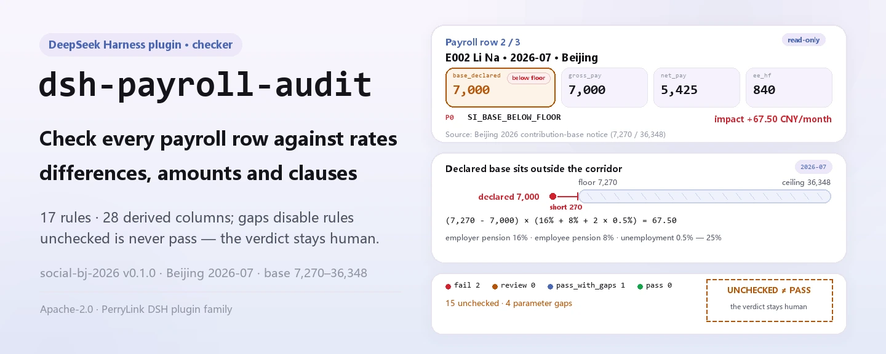
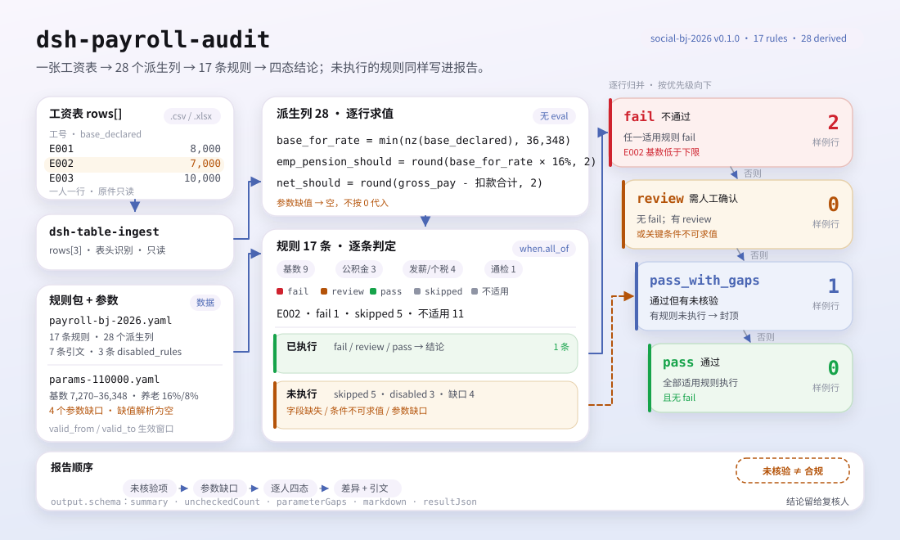

<div align="center">

<picture>
  <source media="(prefers-color-scheme: dark)" srcset="docs/assets/dsh-payroll-audit-hero-en-dark.webp">
  
</picture>

# dsh-payroll-audit

**Check a payroll sheet line by line against published social-insurance, housing-fund and income-tax parameters — every difference with its reason, clause and amount.**

A payroll-audit plugin for DeepSeek Harness, made for payroll, HR and finance: give it a payroll sheet and it checks each row's contribution base, rates, scheme coverage, gross-to-net arithmetic and cumulative withholding. A parameter that was never obtained is reported as unchecked — "not checked" is never rendered as "compliant".

[Install](#three-step-setup) · [Configuration](#configuration) · [FAQ](#faq) · [简体中文](README.md) · [English](README.en.md) · [Español](README.es.md) · [Português](README.pt.md) · [हिन्दी](README.hi.md)

[](LICENSE)
[](#compatibility)
[](https://www.npmjs.com/package/dsh-payroll-audit)
[](https://github.com/PerryLink/dsh-payroll-audit/actions/workflows/ci.yml)
[](#compatibility)

[](https://github.com/PerryLink/dsh-payroll-audit/stargazers)
[](https://www.npmjs.com/package/dsh-payroll-audit)
[](https://dshfind.com/plugins/PerryLink/dsh-payroll-audit?ref=badge)
[](https://securityscorecards.dev/viewer/?uri=github.com/PerryLink/dsh-payroll-audit)
[](https://gitee.com/perrylink/dsh-payroll-audit)

```sh
dsh plugin --profile <name> add dsh-payroll-audit
```

</div>

<sub>Community plugin, not affiliated with DeepSeek. Canonical repository: <https://github.com/PerryLink/dsh-payroll-audit> (Gitee is a mirror).</sub>

## What it is

Hand it a payroll sheet (one row per person) and `dsh-payroll-audit` computes each row's contributions, deductions and net pay from its rule pack, then compares them against published social-insurance, housing-fund and income-tax parameters: is the declared base inside the city's floor and ceiling, do contributions equal base × published rate, does net pay follow from gross minus deductions, and does cumulative withholding recompute correctly? Every difference carries a `reason_code`, severity, impact amount and clause citation.

The verdict is deliberately four-valued: `pass`, `pass_with_gaps`, `review`, `fail`. A rule whose parameter was never obtained is listed under `disabled_rules` — it does not run, but it still appears in the report, so "no finding" can never be rendered as "compliant". Parameters resolve against their `valid_from` / `valid_to` window; a value outside the window resolves to nothing, so the rule falls back to unchecked rather than passing on last year's number.

It is an arithmetic and field-consistency check only: it does not file anything, does not replace the social-insurance agency's own assessment, and does not determine the employment relationship.

<picture>
  <source media="(prefers-color-scheme: dark)" srcset="docs/assets/dsh-payroll-audit-flow-v5-dark.svg">
  
</picture>

## Three-step setup

1. **Install** (npm is published; git and tarball channels are optional):

   ```sh
   # npm channel (published releases)
   dsh plugin --profile web add dsh-payroll-audit
   # git channel (latest main)
   dsh plugin --profile web add github:PerryLink/dsh-payroll-audit
   # tarball channel: pnpm pack in this repo, then
   dsh plugin --profile web add ./dsh-payroll-audit-<version>.tgz
   ```

   The git channel builds `lib/` through `prepare` (`tsdown`); the npm package and tarball already ship `lib/`.

2. **Minimal config** (defaults are usable; `cordis.patch.yml` already inserts the bundle row):

   ```yaml
   - insert:
       - id: dsh-payroll-audit
         name: dsh-payroll-audit
   ```

3. **Verify it works** (the bundled sample is a 3-row Beijing payroll for 2026-07):

   ```sh
   node samples/quickstart/run.mjs --check
   ```

   ```text
   payroll_audit: quickstart OK — output matches expected/result.json
   ```

   The sample is 3 rows, 2 findings, 15 unchecked items and 4 parameter gaps; the expected result is in `samples/quickstart/expected/result.json`.

**Uninstall**: `dsh plugin --profile web remove dsh-payroll-audit` (or remove the row from the profile patch).

## Core capabilities

- **Four-state verdict per row** — `fail` / `review` / `pass_with_gaps` / `pass`. Any row with an unchecked rule can never be `pass`.
- **Rule packs are data** — `rules/payroll-bj-2026.yaml` (17 rules, 28 derived columns) and `rules/payroll-sh-2026.yaml` (7 rules). Derived columns are whitelisted arithmetic expressions (`round`, `min`, `max`, `nz`, `sum`, `abs`, `bracket_rate`); the parser never touches the host scope and there is no `eval`.
- **A missing parameter disables its rule** — entries declared `pending` in the parameter document move their rules into `disabled_rules`; the report lists the parameter gaps and what would unblock them. A missing value resolves to nothing, not 0.
- **Impact amounts** — every firing rule computes an impact, e.g. a base below the floor reports the shortfall: `(7270 − 7000) × (16% + 8% + 2 × 0.5%) = 67.50`.
- **Checkable citations** — every rule carries a `cite`; the citation table gives source, locator and quote, and `check:citations` is a separate gate.
- **Reads spreadsheets directly** — `.xlsx` / `.xlsm` / `.csv` through `dsh-table-ingest`; no conversion step.

### What it answers

- Is a declared contribution base inside the city's floor and ceiling for the period?
- Do the contribution amounts equal the base times the published rate?
- Does net pay follow from gross pay minus the deductions?
- Which rules could not run because a parameter was never obtained?

### What it checks against

Every rule carries citations; the citation table gives source, locator and quote (verbatim text that could not be obtained is marked `paraphrase` or `pending`, with what would unblock it):

- Beijing social-insurance base limits: Beijing Municipal Human Resources and Social Security Bureau, 2026 notice (7,270 / 36,348).
- Beijing housing fund: 5%–12%, base 2,540–36,348.
- Shanghai: base limits 7,546 / 37,731, housing fund **5%–7%** — not the 5%–12% in the national regulation, which is why the range is read from the parameter file rather than hard-coded; supplementary housing fund 1%–5%.
- Individual income tax: cumulative withholding under State Taxation Administration Announcement No. 61 of 2018.

There is no separate evidence directory: the quotations live in the rule pack, next to the rule that uses them. Parameters are addressed by dotted keys (such as `si.base.floor`, `hf.fund.employee_max`) and resolved from the official parameter document; the document carries its own `next_review_by` date, which the report header shows.

### Input format

A payroll sheet is a table with one row per person. The fields the packs read include:

| Field | Meaning |
|---|---|
| `period` | `2026-07`; selects the parameter validity window |
| `base_declared` | Declared contribution base (CNY/month), not the month's gross pay |
| `gross_pay`, `net_pay` | Gross and net pay |
| `employer_pension`, `employee_pension` | Pension contributions as paid (employer / employee) |
| `ee_unemployment`, `ee_medical`, `ee_hf` | Employee-side unemployment, medical and housing fund |
| `hf_base`, `hf_employer_rate`, `hf_employee_rate` | Housing-fund inputs |
| `insurance_set` | Enrolled schemes, comma separated |
| `person_type` | Optional; `rehired_retiree` / `intern` etc. change which base rules apply |
| `iit_withheld`, `cum_*`, `overtime_*`, `prior_base` | Read by the income-tax, overtime and retro-adjustment rules when present |

The file is read through `dsh-table-ingest`, so `.xlsx`, `.xlsm` and `.csv` all work.

### Tool surface

| Surface | Meaning |
|---|---|
| `payroll_audit` | The only registered tool, with `output.schema` and a Markdown projection |
| `file` | Absolute path of the payroll sheet (`.xlsx` / `.xlsm` / `.csv`) |
| `period` | Payroll period, e.g. `2026-07`; defaults to the sheet's `period` column |
| `rulePackFile` / `paramsFile` | Per-call override of the configured rule pack / parameter file |
| `timeoutMs` | Tool timeout budget, from config |

### Example

```text
$ node samples/quickstart/run.mjs
payroll_audit: 3 rows, 2 finding(s) — fail 2, review 0, pass_with_gaps 1, pass 0
unchecked items: 15; parameter gaps: 4
```

*Observed from `samples/quickstart/run.mjs:59-66`; expected summary in `samples/quickstart/expected/result.json`.*

## Configuration

Every tunable is a Schemastery `Config` field (see `src/config.ts`), overridable from `cordis.yml`; both path keys resolve relative to the package root. Overriding by `id` replaces the whole row, so restate every key you need.

| Key | Default | Meaning |
|---|---|---|
| `timeoutMs` | `120000` | `payroll_audit` tool timeout budget in milliseconds |
| `rulePackFile` | `rules/payroll-bj-2026.yaml` | Rule-pack path; use `rules/payroll-sh-2026.yaml` for Shanghai |
| `paramsFile` | `rules/params-110000.yaml` | Parameter-document path; Shanghai uses `rules/params-310000.yaml` |

Profile-patch override example:

```yaml
- insert:
    - id: dsh-payroll-audit
      name: dsh-payroll-audit
      config:
        rulePackFile: rules/payroll-sh-2026.yaml
        paramsFile: rules/params-310000.yaml
```

## FAQ

<details>
<summary>What happens when a parameter was not obtained? Does it silently use zero?</summary>

No. The parameter document declares the missing rate or threshold as `pending` and lists the rules it blocks; those rules go into `disabled_rules`, never run, and appear in the report's "unchecked (not proof of compliance)" section. The value itself resolves to nothing rather than 0, so any derived column depending on it cannot be computed, the rule is `skipped`, and the row is at best `pass_with_gaps`.

</details>

<details>
<summary>Where does the data live? Is anything uploaded or sent to a model?</summary>

The plugin only reads the payroll file you pass at call time: it does not write the original back, does not build a cache, makes no network requests and calls no model. All computation is local. Tool results (including the report text) enter the DSH session record like any other tool result, so decide according to your data classification whether a real payroll sheet should enter a session.

</details>

<details>
<summary>Will it collide with other plugins' tool names, services or events?</summary>

It registers exactly one tool, `payroll_audit`, with `inject: ['tools']`; it provides no service keys, registers no client slots, no `webServer` prefix, listens to no shared events and mutates no globals. The only shared surface is the tool name itself: if another plugin also registers the bare name `payroll_audit`, DSH tool registration will collide — a naming-convention issue, not a hidden side effect.

</details>

<details>
<summary>What is the performance cost?</summary>

Pure local arithmetic: per row it evaluates the pack's derived columns, then tests each rule; the Beijing pack is 17 rules and 28 derived columns, with no network or model calls. The default timeout budget is `120000` ms, far more than a few-hundred-row payroll sheet needs.

</details>

<details>
<summary>It installs but the tool never appears, or `dsh plugin add` rejects the package?</summary>

First confirm `pnpm run build` produced `lib/index.mjs` (that is what `package.json#main` points to), then confirm the host version is inside `>=0.2.1-0 <0.3.0`. A rejected package usually means the peer range does not match; do not force-install an older DSH core. When a rule does not run, read the report's "unchecked" section plus the tool's `uncheckedCount` and `parameterGaps`.

</details>

## Security boundaries

- **Checks, does not adjudicate.** This is an arithmetic and field-consistency check, not a filing, an audit opinion, or a determination of the employment relationship; it submits nothing, does not replace the social-insurance agency's assessment, and does not tell you whether a person should be enrolled.
- **Unchecked ≠ compliant.** When a parameter is missing or a field is absent, the rule does not run and is listed under "unchecked" and "parameter gaps"; `pass_with_gaps` is not `pass`. The report says "no discrepancy among the checked items", never "compliant".
- **Fails closed.** A wrong parameter-document schema, a rule condition missing `field` / `op`, an empty `rules` list, or the same rule in both `rules` and `disabled_rules` all raise at load time rather than slipping through.
- **Read-only input.** The tool reads the given path; it never writes back or produces a corrected payroll sheet.
- **No fabricated citations.** The citation table gives `source`, `locator` and `quote`; clauses whose verbatim text was not obtained are explicitly marked `paraphrase` or `pending`, with what would unblock them.
- **No network, no model call at runtime.** The only runtime dependency is `dsh-table-ingest`, used to read the sheet.

## Known limitations

- **Limited cities and periods.** Only Beijing (`110000`) and Shanghai (`310000`) packs from 2026-07 onward; earlier periods have no parameters, so rules degrade to unchecked. One pack maps to one city — switch `rulePackFile` / `paramsFile` or override per call for the other city.
- **Disabled checks.** Medical, maternity, injury-rate tiers and minimum wage are disabled because no primary rate or standard was obtained: 3 rules disabled for Beijing, 4 for Shanghai; the report lists each reason and unblock condition.
- **Mixed evidence levels.** Beijing social-insurance limits, Beijing housing fund, Shanghai limits and Shanghai housing fund are verbatim quotations; Shanghai pension and unemployment rates are still `paraphrase`, so those rules are disabled in the pack; the income-tax bracket values are also `paraphrase` and need verbatim citations before release. The cumulative-withholding formula cites State Taxation Administration Announcement No. 61 of 2018, Article 6.
- **The rule language supports `when.all_of` only.** The engine explicitly rejects other condition shapes; a malformed pack fails at load time.
- **The YAML reader is an in-repo subset parser**, not a full YAML implementation; packs and parameter documents stay inside that subset.
- **No corrected payroll sheet** is computed, no filing document is generated, and no compliance conclusion is offered.
- **Amount tolerance is 1.00 CNY**, rates are back-solved from amounts, and rounding is half-up to the fen (declared as `round_half_up_to_fen` in the packs).
- **The sheet needs a period.** If it has no `period` column, the call must pass `period` (for example `2026-07`); otherwise the tool raises.

## Interoperability with other DSH plugins

The plugin registers one tool, `payroll_audit`, and waits for the `tools` service via `inject: ['tools']`; it provides no service keys, registers no client slots, no `webServer` prefix, listens to no shared events, and rewrites no globals. It therefore contends for no shared surface beyond the tool name, and cannot short-circuit another plugin's call chain.

Rule packs and parameter documents are plain YAML under the package's `rules/`, readable or generatable by other tools; the plugin depends on no runtime state outside itself. The only naming risk is the bare tool name `payroll_audit`: if another plugin registers the same name, DSH registration will collide.

## Compatibility

| Dimension | Status |
|---|---|
| Harness | `engines.dsh` is `>=0.2.1-0 <0.3.0`; the `@deepseek-ai/dsh-tools` peer covers `0.1.x` and `0.2.x` |
| Node | `^22.19.0 \|\| >=24.0.0` |
| Platforms | anywhere DSH runs (pure ESM, no native code, no network, no model call) |
| Input | `.xlsx` / `.xlsm` / `.csv` (through `dsh-table-ingest`) |
| Verification | `pnpm test` 25/25 (recorded in `ACCEPTANCE.csv`) |

## Ecosystem & quality

- [Gitee mirror](https://gitee.com/perrylink/dsh-payroll-audit) (synchronized mirror; GitHub is canonical)
- [dshfind plugin page](https://dshfind.com/plugins/PerryLink/dsh-payroll-audit) (installs and ranking)
- [OpenSSF Scorecard report](https://securityscorecards.dev/viewer/?uri=github.com/PerryLink/dsh-payroll-audit) (driven by [.github/workflows/scorecard.yml](.github/workflows/scorecard.yml))

## Development

```sh
pnpm install
pnpm run typecheck
pnpm test
pnpm run build
pnpm run verify:self-contained
pnpm run check:lockfile
pnpm run check:readmes
pnpm run check:citations
pnpm pack
```

Layout:

| Path | Contents |
|---|---|
| `src/index.ts` | Function-plugin entry: registers `payroll_audit`, resolves pack and parameter paths |
| `src/config.ts` | Schemastery `Config`: `timeoutMs` / `rulePackFile` / `paramsFile` |
| `src/engine.ts` | Pure audit core: derived columns, rule evaluation, four-state verdict |
| `src/expr.ts` | Restricted expression parser and evaluator (whitelisted AST) |
| `src/params.ts` | Parameter loading: dotted keys, validity windows, gaps and provenance |
| `src/report.ts` | Report rendering: unchecked first, then the findings |
| `src/shared/` | In-repo shared kit: YAML subset, ruleset, table and wording guards |
| `rules/` | Two rule packs, two parameter documents, citation baseline |
| `samples/quickstart/` | 3-row Beijing sample, expected result, `--check` script |
| `tests/` | vitest: rules, parameters, expressions and boundary semantics |
| `scripts/` | Four gates: self-contained, lockfile, README sync, citations |
| `docs/assets/` | README figures and demo material |

Figures are generated by [`scripts/gen-readme-assets.py`](scripts/gen-readme-assets.py) (Python): four hero WebP files (zh/en × light/dark) and two flow-v5 SVGs, drawn from the shipped rule pack and sample. Re-run with `python scripts/gen-readme-assets.py`.

Topics: `dsh`, `dsh-plugin`, `deepseek-harness`, `deepseek`, `cordis`, `payroll`, `social`

## Family & thanks

This project is a member of the DeepSeek Harness plugin family maintained by [PerryLink](https://github.com/PerryLink) (all Apache-2.0). The full index is at [choose a checker by material](https://perrylink.github.io/zh/checkers/choose/) and [all plugins](https://github.com/PerryLink). If this plugin helped you, **give it a star** — it unlocks nothing, but it helps the next person find it.

- [@PerryLink](https://github.com/PerryLink) — creator and maintainer: rule engine, two-city parameter library, rule packs and five-language docs.

<details>
<summary>Show all plugins</summary>

| Plugin | Status |
|---|---|
| **[dsh-aqua-input-check](https://github.com/PerryLink/dsh-aqua-input-check)** | |
| **[dsh-archive-check](https://github.com/PerryLink/dsh-archive-check)** | |
| **[dsh-auto-review](https://github.com/PerryLink/dsh-auto-review)** | |
| **[dsh-autotier](https://github.com/PerryLink/dsh-autotier)** | 🧊 FROZEN — see the repo README |
| **[dsh-bid-ca-precheck](https://github.com/PerryLink/dsh-bid-ca-precheck)** | |
| **[dsh-bid-qual-check](https://github.com/PerryLink/dsh-bid-qual-check)** | |
| **[dsh-cert-mcp](https://github.com/PerryLink/dsh-cert-mcp)** | 🧊 FROZEN — see the repo README |
| **[dsh-checkpoint-rewind](https://github.com/PerryLink/dsh-checkpoint-rewind)** | |
| **[dsh-click](https://github.com/PerryLink/dsh-click)** | |
| **[dsh-composer-history](https://github.com/PerryLink/dsh-composer-history)** | |
| **[dsh-contract-stance](https://github.com/PerryLink/dsh-contract-stance)** | |
| **[dsh-customs-doc-check](https://github.com/PerryLink/dsh-customs-doc-check)** | |
| **[dsh-data-quality](https://github.com/PerryLink/dsh-data-quality)** | 🧊 FROZEN — see the repo README |
| **[dsh-demurrage-ledger](https://github.com/PerryLink/dsh-demurrage-ledger)** | |
| **[dsh-doublecheck](https://github.com/PerryLink/dsh-doublecheck)** | |
| **[dsh-drill-script-check](https://github.com/PerryLink/dsh-drill-script-check)** | |
| **[dsh-eia-guide-check](https://github.com/PerryLink/dsh-eia-guide-check)** | |
| **[dsh-emergency-plan](https://github.com/PerryLink/dsh-emergency-plan)** | |
| **[dsh-essay-rubric-check](https://github.com/PerryLink/dsh-essay-rubric-check)** | |
| **[dsh-evidence-check](https://github.com/PerryLink/dsh-evidence-check)** | |
| **[dsh-export-ctl-check](https://github.com/PerryLink/dsh-export-ctl-check)** | |
| **[dsh-fast](https://github.com/PerryLink/dsh-fast)** | |
| **[dsh-fmea-table-check](https://github.com/PerryLink/dsh-fmea-table-check)** | |
| **[dsh-forecast-penalty](https://github.com/PerryLink/dsh-forecast-penalty)** | |
| **[dsh-fund-research](https://github.com/PerryLink/dsh-fund-research)** | |
| **[dsh-github](https://github.com/PerryLink/dsh-github)** | |
| **[dsh-gongwen-flow-check](https://github.com/PerryLink/dsh-gongwen-flow-check)** | |
| **[dsh-gongwen-word-check](https://github.com/PerryLink/dsh-gongwen-word-check)** | |
| **[dsh-guard-plan-qc](https://github.com/PerryLink/dsh-guard-plan-qc)** | |
| **[dsh-hazchem-check](https://github.com/PerryLink/dsh-hazchem-check)** | |
| **[dsh-hazplan-check](https://github.com/PerryLink/dsh-hazplan-check)** | |
| **[dsh-hidden-risk-map](https://github.com/PerryLink/dsh-hidden-risk-map)** | |
| **[dsh-hs-classify](https://github.com/PerryLink/dsh-hs-classify)** | |
| **[dsh-icd-rule-check](https://github.com/PerryLink/dsh-icd-rule-check)** | |
| **[dsh-industry-research](https://github.com/PerryLink/dsh-industry-research)** | |
| **[dsh-lawcite-adapter](https://github.com/PerryLink/dsh-lawcite-adapter)** | |
| **[dsh-laya](https://github.com/PerryLink/dsh-laya)** | |
| **[dsh-lc-doc-check](https://github.com/PerryLink/dsh-lc-doc-check)** | |
| **[dsh-learning-gap-check](https://github.com/PerryLink/dsh-learning-gap-check)** | |
| **[dsh-library](https://github.com/PerryLink/dsh-library)** | |
| **[dsh-local-ai](https://github.com/PerryLink/dsh-local-ai)** | |
| **[dsh-lsp-actions](https://github.com/PerryLink/dsh-lsp-actions)** | |
| **[dsh-mask](https://github.com/PerryLink/dsh-mask)** | |
| **[dsh-mcp-panel](https://github.com/PerryLink/dsh-mcp-panel)** | |
| **[dsh-medrec-qc](https://github.com/PerryLink/dsh-medrec-qc)** | |
| **[dsh-memento](https://github.com/PerryLink/dsh-memento)** | 🧊 FROZEN — see the repo README |
| **[dsh-nsfc-form-check](https://github.com/PerryLink/dsh-nsfc-form-check)** | |
| **[dsh-nurse-record-check](https://github.com/PerryLink/dsh-nurse-record-check)** | |
| **[dsh-observe](https://github.com/PerryLink/dsh-observe)** | |
| **[dsh-origin-rvc-check](https://github.com/PerryLink/dsh-origin-rvc-check)** | |
| **[dsh-ota-review-check](https://github.com/PerryLink/dsh-ota-review-check)** | |
| **[dsh-output-styles](https://github.com/PerryLink/dsh-output-styles)** | |
| **[dsh-paper-doc-adapter](https://github.com/PerryLink/dsh-paper-doc-adapter)** | |
| **[dsh-permission-rules](https://github.com/PerryLink/dsh-permission-rules)** | |
| **[dsh-permit-report-check](https://github.com/PerryLink/dsh-permit-report-check)** | |
| **[dsh-pipeline-check](https://github.com/PerryLink/dsh-pipeline-check)** | |
| **[dsh-pleading-draft](https://github.com/PerryLink/dsh-pleading-draft)** | |
| **[dsh-plugin-doctor](https://github.com/PerryLink/dsh-plugin-doctor)** | 🚫 RETIRED (repo archived) |
| **[dsh-plugin-guide](https://github.com/PerryLink/dsh-plugin-guide)** | |
| **[dsh-plugin-kit](https://github.com/PerryLink/dsh-plugin-kit)** | 🚫 RETIRED (repo archived) |
| **[dsh-plugin-upgrade](https://github.com/PerryLink/dsh-plugin-upgrade)** | 🚫 RETIRED (repo archived) |
| **[dsh-policy-brief-draft](https://github.com/PerryLink/dsh-policy-brief-draft)** | |
| **[dsh-power-loss-split](https://github.com/PerryLink/dsh-power-loss-split)** | |
| **[dsh-power-ticket-check](https://github.com/PerryLink/dsh-power-ticket-check)** | |
| **[dsh-ppap-check](https://github.com/PerryLink/dsh-ppap-check)** | |
| **[dsh-protest-deadline](https://github.com/PerryLink/dsh-protest-deadline)** | |
| **[dsh-railway-window](https://github.com/PerryLink/dsh-railway-window)** | |
| **[dsh-repair-order-qc](https://github.com/PerryLink/dsh-repair-order-qc)** | |
| **[dsh-research-report](https://github.com/PerryLink/dsh-research-report)** | |
| **[dsh-review-reply-check](https://github.com/PerryLink/dsh-review-reply-check)** | |
| **[dsh-rulefile-check](https://github.com/PerryLink/dsh-rulefile-check)** | |
| **[dsh-safety-brief-check](https://github.com/PerryLink/dsh-safety-brief-check)** | |
| **[dsh-score](https://github.com/PerryLink/dsh-score)** | 🧊 FROZEN — see the repo README |
| **[dsh-session-sync](https://github.com/PerryLink/dsh-session-sync)** | |
| **[dsh-site-log-check](https://github.com/PerryLink/dsh-site-log-check)** | |
| **[dsh-skill-pack-security](https://github.com/PerryLink/dsh-skill-pack-security)** | |
| **[dsh-soe-decision-check](https://github.com/PerryLink/dsh-soe-decision-check)** | |
| **[dsh-soilwater-check](https://github.com/PerryLink/dsh-soilwater-check)** | |
| **[dsh-sop-sync-check](https://github.com/PerryLink/dsh-sop-sync-check)** | |
| **[dsh-spc-gbt-adapter](https://github.com/PerryLink/dsh-spc-gbt-adapter)** | |
| **[dsh-talk](https://github.com/PerryLink/dsh-talk)** | |
| **[dsh-tender-extract](https://github.com/PerryLink/dsh-tender-extract)** | |
| **[dsh-tender-matrix](https://github.com/PerryLink/dsh-tender-matrix)** | |
| **[dsh-test-drive](https://github.com/PerryLink/dsh-test-drive)** | |
| **[dsh-ticktick](https://github.com/PerryLink/dsh-ticktick)** | 🚫 RETIRED (repo archived) |
| **[dsh-translate](https://github.com/PerryLink/dsh-translate)** | |
| **[dsh-warranty-calc](https://github.com/PerryLink/dsh-warranty-calc)** | |
| **[dsh-budget](https://github.com/PerryLink/dsh-budget)** | |
| **[dsh-claude-move](https://github.com/PerryLink/dsh-claude-move)** | |
| **[dsh-defend](https://github.com/PerryLink/dsh-defend)** | |
| **[dsh-draw](https://github.com/PerryLink/dsh-draw)** | 🧊 FROZEN — see the repo README |
| **[dsh-reach](https://github.com/PerryLink/dsh-reach)** | |
| **[dsh-background-agents](https://github.com/PerryLink/dsh-background-agents)** | 🚫 RETIRED (repo archived) |
| **[dsh-session-pin](https://github.com/PerryLink/dsh-session-pin)** | 🚫 RETIRED (repo archived) |
| **[dsh-team-rooms](https://github.com/PerryLink/dsh-team-rooms)** | 🚫 RETIRED (repo archived) |

</details>

## License

[LICENSE](LICENSE) (Apache License 2.0) © 2026 dsh-payroll-audit contributors

<p align="center"><sub>Apache-2.0 · Community plugin, not affiliated with DeepSeek.</sub></p>
