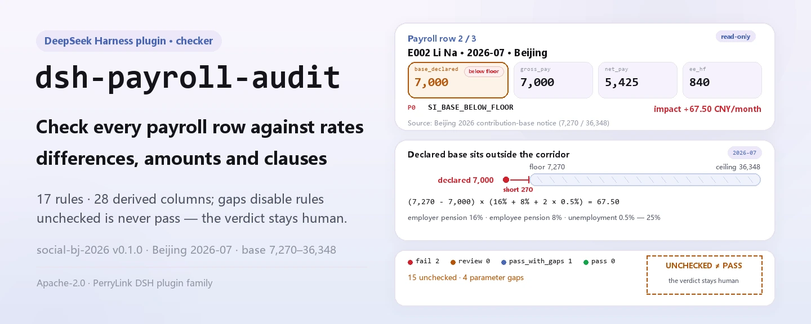
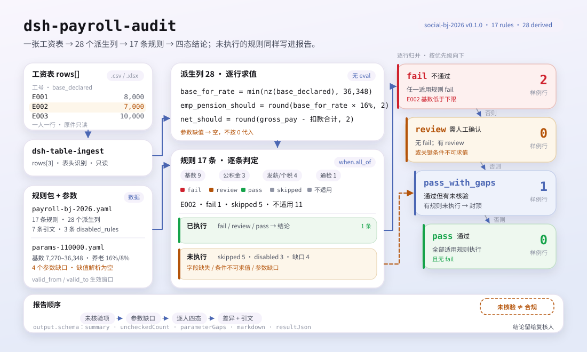

<div align="center">

<picture>
  <source media="(prefers-color-scheme: dark)" srcset="docs/assets/dsh-payroll-audit-hero-en-dark.webp">
  
</picture>

# dsh-payroll-audit

**Verifica una hoja de nómina línea por línea contra parámetros publicados de seguridad social, fondo de vivienda e impuesto sobre la renta: cada diferencia con su motivo, su cláusula y su importe.**

Un plugin de auditoría de nómina para DeepSeek Harness, pensado para nóminas, RR. HH. y finanzas: le das una hoja de nómina y comprueba en cada fila la base de cotización, los tipos, la cobertura de seguros, el encadenamiento bruto-neto y la retención acumulada. Un parámetro que nunca se obtuvo se informa como no verificado: «no comprobado» nunca se presenta como «cumple».

[Instalar](#instalación-en-tres-pasos) · [Configuración](#configuración) · [FAQ](#faq) · [简体中文](README.md) · [English](README.en.md) · [Español](README.es.md) · [Português](README.pt.md) · [हिन्दी](README.hi.md)

[](LICENSE)
[](#compatibilidad)
[](https://www.npmjs.com/package/dsh-payroll-audit)
[](https://github.com/PerryLink/dsh-payroll-audit/actions/workflows/ci.yml)
[](#compatibilidad)

[](https://github.com/PerryLink/dsh-payroll-audit/stargazers)
[](https://www.npmjs.com/package/dsh-payroll-audit)
[](https://dshfind.com/plugins/PerryLink/dsh-payroll-audit?ref=badge)
[](https://securityscorecards.dev/viewer/?uri=github.com/PerryLink/dsh-payroll-audit)
[](https://gitee.com/perrylink/dsh-payroll-audit)

```sh
dsh plugin --profile <name> add dsh-payroll-audit
```

</div>

<sub>Plugin de la comunidad, no afiliado a DeepSeek. Repositorio canónico: <https://github.com/PerryLink/dsh-payroll-audit> (Gitee es un espejo).</sub>

## Qué es

Dale una hoja de nómina (una fila por persona) y `dsh-payroll-audit` calcula en cada fila las cotizaciones, las deducciones y el neto a partir de su paquete de reglas, y luego los compara con parámetros publicados de seguridad social, fondo de vivienda e impuesto sobre la renta: ¿la base declarada está dentro del mínimo y el máximo de la ciudad?, ¿la cotización equivale a la base por el tipo publicado?, ¿el neto sale del bruto menos las deducciones?, ¿la retención acumulada se recalcula correctamente? Cada diferencia lleva `reason_code`, severidad, importe de impacto y cita de la cláusula.

El veredicto es deliberadamente de cuatro estados: `pass`, `pass_with_gaps`, `review`, `fail`. Una regla cuyo parámetro nunca se obtuvo figura en `disabled_rules`: no se ejecuta, pero sigue apareciendo en el informe, así que «sin hallazgos» nunca se presenta como «cumple». Los parámetros se resuelven según su ventana `valid_from` / `valid_to`; un valor fuera de la ventana se resuelve como vacío, de modo que la regla pasa a no verificada en lugar de decidir con la cifra del año pasado.

Solo comprueba aritmética y consistencia de campos: no presenta nada, no sustituye la liquidación del organismo gestor y no determina la relación laboral.

<picture>
  <source media="(prefers-color-scheme: dark)" srcset="docs/assets/dsh-payroll-audit-flow-v5-dark.svg">
  
</picture>

## Instalación en tres pasos

1. **Instala** (npm está publicado; los canales git y tarball son opcionales):

   ```sh
   # canal npm (versiones publicadas)
   dsh plugin --profile web add dsh-payroll-audit
   # canal git (último main)
   dsh plugin --profile web add github:PerryLink/dsh-payroll-audit
   # canal tarball: pnpm pack en este repo y luego
   dsh plugin --profile web add ./dsh-payroll-audit-<version>.tgz
   ```

   El canal git construye `lib/` mediante `prepare` (`tsdown`); el paquete npm y el tarball ya incluyen `lib/`.

2. **Configuración mínima** (los valores por defecto ya funcionan; `cordis.patch.yml` ya inserta la fila del bundle):

   ```yaml
   - insert:
       - id: dsh-payroll-audit
         name: dsh-payroll-audit
   ```

3. **Verifica que funciona** (el ejemplo incluido es una nómina de Pekín de 2026-07 con 3 filas):

   ```sh
   node samples/quickstart/run.mjs --check
   ```

   ```text
   payroll_audit: quickstart OK — output matches expected/result.json
   ```

   El ejemplo da 3 filas, 2 diferencias, 15 elementos no verificados y 4 huecos de parámetros; el resultado esperado está en `samples/quickstart/expected/result.json`.

**Desinstalar**: `dsh plugin --profile web remove dsh-payroll-audit` (o elimina la fila del patch del perfil).

## Capacidades clave

- **Veredicto de cuatro estados por fila** — `fail` / `review` / `pass_with_gaps` / `pass`. Una fila con cualquier regla sin ejecutar nunca puede ser `pass`.
- **Los paquetes de reglas son datos** — `rules/payroll-bj-2026.yaml` (17 reglas, 28 columnas derivadas) y `rules/payroll-sh-2026.yaml` (7 reglas). Las columnas derivadas son expresiones aritméticas de lista blanca (`round`, `min`, `max`, `nz`, `sum`, `abs`, `bracket_rate`); el analizador no toca el ámbito del host y no hay `eval`.
- **Un parámetro ausente desactiva su regla** — las entradas declaradas `pending` en el documento de parámetros llevan sus reglas a `disabled_rules`; el informe enumera los huecos y qué los desbloquearía. Un valor ausente se resuelve como vacío, no como 0.
- **Importes de impacto** — cada regla que dispara calcula su impacto; por ejemplo, una base por debajo del mínimo informa la cotización faltante: `(7270 − 7000) × (16% + 8% + 2 × 0.5%) = 67.50`.
- **Citas verificables** — cada regla lleva `cite`; la tabla de citas da fuente, localizador y cita, y `check:citations` es una puerta independiente.
- **Lee hojas de cálculo directamente** — `.xlsx` / `.xlsm` / `.csv` mediante `dsh-table-ingest`, sin paso de conversión.

### Qué responde

- ¿La base declarada está dentro del mínimo y el máximo de la ciudad para el periodo?
- ¿Los importes de cotización equivalen a la base por el tipo publicado?
- ¿El neto sale del bruto menos las deducciones?
- ¿Qué reglas no pudieron ejecutarse porque el parámetro nunca se obtuvo?

### Con qué se contrasta

Cada regla lleva citas; la tabla de citas da fuente, localizador y cita (el texto literal que no se pudo obtener se marca `paraphrase` o `pending`, con lo que lo desbloquearía):

- Límites de base de seguridad social de Pekín: aviso de 2026 de la Oficina Municipal de Recursos Humanos y Seguridad Social de Pekín (7.270 / 36.348).
- Fondo de vivienda de Pekín: 5%–12%, base 2.540–36.348.
- Shanghái: límites de base 7.546 / 37.731, fondo de vivienda **5%–7%** — no el 5%–12% del reglamento nacional, por eso el rango se lee del archivo de parámetros y no se codifica; fondo de vivienda complementario 1%–5%.
- Impuesto sobre la renta: retención acumulada según el Anuncio n.º 61 de 2018 de la Administración Estatal de Impuestos.

No hay un directorio de evidencias aparte: las citas viven en el paquete de reglas, junto a la regla que las usa. Los parámetros se direccionan con claves con puntos (como `si.base.floor`, `hf.fund.employee_max`) y se resuelven desde el documento oficial de parámetros; el documento trae su propio `next_review_by`, que el encabezado del informe muestra.

### Formato de entrada

Una hoja de nómina es una tabla con una fila por persona. Los campos que leen los paquetes incluyen:

| Campo | Significado |
|---|---|
| `period` | `2026-07`; selecciona la ventana de vigencia de los parámetros |
| `base_declared` | Base de cotización declarada (CNY/mes), no el bruto del mes |
| `gross_pay`, `net_pay` | Bruto y neto |
| `employer_pension`, `employee_pension` | Cotizaciones de pensión pagadas (empresa / persona) |
| `ee_unemployment`, `ee_medical`, `ee_hf` | Desempleo, medicina y fondo de vivienda del lado del empleado |
| `hf_base`, `hf_employer_rate`, `hf_employee_rate` | Entradas del fondo de vivienda |
| `insurance_set` | Seguros suscritos, separados por comas |
| `person_type` | Opcional; `rehired_retiree` / `intern`, etc. cambian qué reglas de base aplican |
| `iit_withheld`, `cum_*`, `overtime_*`, `prior_base` | Los leen las reglas de impuesto, horas extra y regularización cuando existen |

El archivo se lee mediante `dsh-table-ingest`, así que `.xlsx`, `.xlsm` y `.csv` funcionan.

### Superficie de la herramienta

| Superficie | Significado |
|---|---|
| `payroll_audit` | La única herramienta registrada, con `output.schema` y proyección Markdown |
| `file` | Ruta absoluta de la hoja de nómina (`.xlsx` / `.xlsm` / `.csv`) |
| `period` | Periodo de nómina, p. ej. `2026-07`; por defecto, la columna `period` de la hoja |
| `rulePackFile` / `paramsFile` | Sustitución por llamada del paquete de reglas / documento de parámetros configurado |
| `timeoutMs` | Presupuesto de tiempo de espera de la herramienta, desde la configuración |

### Ejemplo

```text
$ node samples/quickstart/run.mjs
payroll_audit: 3 rows, 2 finding(s) — fail 2, review 0, pass_with_gaps 1, pass 0
unchecked items: 15; parameter gaps: 4
```

*Observed from `samples/quickstart/run.mjs:59-66`; expected summary in `samples/quickstart/expected/result.json`.*

## Configuración

Todo lo ajustable es un campo Schemastery `Config` (ver `src/config.ts`), sobrescribible desde `cordis.yml`; ambas claves de ruta se resuelven respecto a la raíz del paquete. Sobrescribir por `id` reemplaza la fila entera, así que repite todas las claves que necesites.

| Clave | Valor por defecto | Significado |
|---|---|---|
| `timeoutMs` | `120000` | Presupuesto de tiempo de espera de `payroll_audit` en milisegundos |
| `rulePackFile` | `rules/payroll-bj-2026.yaml` | Ruta del paquete de reglas; para Shanghái usa `rules/payroll-sh-2026.yaml` |
| `paramsFile` | `rules/params-110000.yaml` | Ruta del documento de parámetros; Shanghái usa `rules/params-310000.yaml` |

Ejemplo de sobrescritura en el patch del perfil:

```yaml
- insert:
    - id: dsh-payroll-audit
      name: dsh-payroll-audit
      config:
        rulePackFile: rules/payroll-sh-2026.yaml
        paramsFile: rules/params-310000.yaml
```

## FAQ

<details>
<summary>¿Qué pasa si no se obtuvo un parámetro? ¿Se usa cero en silencio?</summary>

No. El documento de parámetros declara el tipo o umbral ausente como `pending` y enumera las reglas que bloquea; esas reglas pasan a `disabled_rules`, no se ejecutan nunca y aparecen en la sección «no verificado (no es prueba de cumplimiento)» del informe. El valor se resuelve como vacío, no como 0, así que cualquier columna derivada que dependa de él no se puede calcular, la regla queda `skipped` y la fila es como mucho `pass_with_gaps`.

</details>

<details>
<summary>¿Dónde viven los datos? ¿Se sube algo o se envía a un modelo?</summary>

El plugin solo lee el archivo de nómina que le pasas en la llamada: no reescribe el original, no crea caché, no hace peticiones de red y no llama a ningún modelo. Todo el cálculo es local. Los resultados de la herramienta (incluido el texto del informe) entran en el registro de sesión de DSH como los de cualquier herramienta, así que decide según tu clasificación de datos si una nómina real debe entrar en una sesión.

</details>

<details>
<summary>¿Chocará con nombres de herramientas, servicios o eventos de otros plugins?</summary>

Registra exactamente una herramienta, `payroll_audit`, con `inject: ['tools']`; no aporta claves de servicio, no registra slots de cliente, ni prefijo `webServer`, no escucha eventos compartidos y no modifica objetos globales. La única superficie compartida es el nombre de la herramienta: si otro plugin también registra el nombre desnudo `payroll_audit`, el registro de herramientas de DSH chocará; es un problema de convención de nombres, no un efecto secundario oculto.

</details>

<details>
<summary>¿Cuánto cuesta en rendimiento?</summary>

Aritmética local pura: por fila evalúa las columnas derivadas del paquete y luego prueba cada regla; el paquete de Pekín tiene 17 reglas y 28 columnas derivadas, sin red ni llamadas a modelos. El presupuesto de tiempo por defecto es de `120000` ms, mucho más de lo que necesita una nómina de unos cientos de filas.

</details>

<details>
<summary>Se instala pero la herramienta no aparece, ¿o `dsh plugin add` rechaza el paquete?</summary>

Primero confirma que `pnpm run build` produjo `lib/index.mjs` (es lo que apunta `package.json#main`); después confirma que la versión del host está dentro de `>=0.2.1-0 <0.3.0`. Un paquete rechazado suele significar que el rango de peers no coincide; no fuerces la instalación de un núcleo DSH antiguo. Cuando una regla no se ejecuta, lee la sección «no verificado» del informe y los valores `uncheckedCount` y `parameterGaps` de la herramienta.

</details>

## Límites de seguridad

- **Comprueba, no dictamina.** Es una comprobación aritmética y de consistencia de campos, no una declaración, ni un dictamen de auditoría, ni una determinación de la relación laboral; no presenta nada, no sustituye la liquidación del organismo gestor y no dice si una persona debe estar afiliada.
- **No verificado ≠ cumple.** Cuando falta un parámetro o un campo, la regla no se ejecuta y se enumera en «no verificado» y «huecos de parámetros»; `pass_with_gaps` no es `pass`. El informe dice «no se encontraron diferencias entre los elementos verificados», nunca «cumple».
- **Falla cerrado.** Un esquema de parámetros incorrecto, una condición de regla sin `field` / `op`, una lista `rules` vacía o la misma regla en `rules` y `disabled_rules` fallan al cargar en lugar de pasar desapercibidos.
- **Entrada de solo lectura.** La herramienta lee la ruta indicada; nunca reescribe ni genera una nómina corregida.
- **Sin citas inventadas.** La tabla de citas da `source`, `locator` y `quote`; las cláusulas cuyo texto literal no se obtuvo se marcan explícitamente como `paraphrase` o `pending`, con lo que las desbloquearía.
- **Sin red ni llamadas a modelos en ejecución.** La única dependencia de ejecución es `dsh-table-ingest`, para leer la hoja.

## Limitaciones conocidas

- **Ciudades y periodos limitados.** Solo hay paquetes de Pekín (`110000`) y Shanghái (`310000`) desde 2026-07; los periodos anteriores no tienen parámetros, así que las reglas pasan a no verificadas. Un paquete corresponde a una ciudad: cambia `rulePackFile` / `paramsFile` o sobrescribe en la llamada para la otra.
- **Comprobaciones desactivadas.** Medicina, maternidad, tramos de tasa de accidentes y salario mínimo están desactivados porque no se obtuvo la tasa o el estándar de primera mano: 3 reglas desactivadas en Pekín y 4 en Shanghái; el informe detalla cada motivo y su condición de desbloqueo.
- **Niveles de evidencia mixtos.** Los límites de seguridad social de Pekín, el fondo de vivienda de Pekín, los límites de Shanghái y el fondo de vivienda de Shanghái son citas literales; las tasas de pensión y desempleo de Shanghái siguen en `paraphrase`, por lo que esas reglas están desactivadas en el paquete; los valores de la tabla del impuesto sobre la renta también son `paraphrase` y necesitan citas literales antes de publicar. La fórmula de retención acumulada cita el Anuncio n.º 61 de 2018 de la Administración Estatal de Impuestos, artículo 6.
- **El lenguaje de reglas solo admite `when.all_of`.** El motor rechaza explícitamente otras formas de condición; un paquete mal formado falla al cargar.
- **El lector YAML es un analizador de subconjunto propio**, no una implementación completa de YAML; los paquetes y documentos de parámetros se mantienen dentro de ese subconjunto.
- **No se calcula una nómina corregida**, no se genera un documento de declaración y no se ofrece una conclusión de cumplimiento.
- **La tolerancia de importes es de 1,00 CNY**, los tipos se deducen de los importes y el redondeo es al alza hasta el fen (declarado como `round_half_up_to_fen` en los paquetes).
- **La hoja necesita un periodo.** Si no tiene columna `period`, la llamada debe pasar `period` (por ejemplo `2026-07`); de lo contrario la herramienta falla.

## Interoperabilidad con otros plugins DSH

El plugin registra una herramienta, `payroll_audit`, y espera el servicio `tools` mediante `inject: ['tools']`; no aporta claves de servicio, no registra slots de cliente, ni prefijo `webServer`, no escucha eventos compartidos y no reescribe objetos globales. Por tanto no compite por ninguna superficie compartida más allá del nombre de la herramienta, y no puede cortocircuitar la cadena de llamadas de otro plugin.

Los paquetes de reglas y los documentos de parámetros son YAML simple bajo `rules/` del paquete, legibles o generables por otras herramientas; el plugin no depende de estado de ejecución fuera de sí mismo. El único riesgo de nombres es el nombre desnudo `payroll_audit`: si otro plugin registra el mismo nombre, el registro de DSH chocará.

## Compatibilidad

| Dimensión | Estado |
|---|---|
| Harness | `engines.dsh` es `>=0.2.1-0 <0.3.0`; el peer `@deepseek-ai/dsh-tools` cubre `0.1.x` y `0.2.x` |
| Node | `^22.19.0 \|\| >=24.0.0` |
| Plataformas | donde sea que corra DSH (ESM puro, sin código nativo, sin red, sin llamadas a modelos) |
| Entrada | `.xlsx` / `.xlsm` / `.csv` (mediante `dsh-table-ingest`) |
| Verificación | `pnpm test` 25/25 (registrado en `ACCEPTANCE.csv`) |

## Ecosistema y calidad

- [Espejo en Gitee](https://gitee.com/perrylink/dsh-payroll-audit) (espejo sincronizado; GitHub es el canónico)
- [Página del plugin en dshfind](https://dshfind.com/plugins/PerryLink/dsh-payroll-audit) (instalaciones y ranking)
- [Informe OpenSSF Scorecard](https://securityscorecards.dev/viewer/?uri=github.com/PerryLink/dsh-payroll-audit) (impulsado por [.github/workflows/scorecard.yml](.github/workflows/scorecard.yml))

## Desarrollo

```sh
pnpm install
pnpm run typecheck
pnpm test
pnpm run build
pnpm run verify:self-contained
pnpm run check:lockfile
pnpm run check:readmes
pnpm run check:citations
pnpm pack
```

Estructura:

| Ruta | Contenido |
|---|---|
| `src/index.ts` | Entrada del plugin-función: registra `payroll_audit`, resuelve rutas de paquete y parámetros |
| `src/config.ts` | Schemastery `Config`: `timeoutMs` / `rulePackFile` / `paramsFile` |
| `src/engine.ts` | Núcleo puro de auditoría: columnas derivadas, evaluación de reglas, veredicto de cuatro estados |
| `src/expr.ts` | Analizador y evaluador de expresiones restringidas (AST de lista blanca) |
| `src/params.ts` | Carga de parámetros: claves con puntos, ventanas de vigencia, huecos y procedencia |
| `src/report.ts` | Renderizado del informe: primero lo no verificado, luego las diferencias |
| `src/shared/` | Kit compartido del repo: subconjunto YAML, ruleset, tabla y guardas de redacción |
| `rules/` | Dos paquetes de reglas, dos documentos de parámetros, línea base de citas |
| `samples/quickstart/` | Ejemplo de Pekín de 3 filas, resultado esperado, script `--check` |
| `tests/` | vitest: reglas, parámetros, expresiones y semántica de límites |
| `scripts/` | Cuatro puertas: autocontenido, lockfile, sincronía de README, citas |
| `docs/assets/` | Figuras del README y material de demostración |

Las figuras las genera [`scripts/gen-readme-assets.py`](scripts/gen-readme-assets.py) (Python): cuatro hero WebP (zh/en × claro/oscuro) y dos SVG flow-v5, a partir del paquete de reglas y la muestra incluidos. Vuelve a ejecutarlo con `python scripts/gen-readme-assets.py`.

Topics: `dsh`, `dsh-plugin`, `deepseek-harness`, `deepseek`, `cordis`, `payroll`, `social`

## Familia y agradecimientos

Este proyecto es miembro de la familia de plugins de DeepSeek Harness mantenida por [PerryLink](https://github.com/PerryLink) (todos Apache-2.0). El índice completo está en [elegir un verificador por material](https://perrylink.github.io/zh/checkers/choose/) y [todos los plugins](https://github.com/PerryLink). Si este plugin te ayudó, **dale una estrella**: no desbloquea nada, pero ayuda a que la siguiente persona lo encuentre.

- [@PerryLink](https://github.com/PerryLink) — creador y mantenedor: motor de reglas, biblioteca de parámetros de dos ciudades, paquetes de reglas y documentación en cinco idiomas.

<details>
<summary>Mostrar todos los plugins</summary>

| Plugin | Estado |
|---|---|
| **[dsh-aqua-input-check](https://github.com/PerryLink/dsh-aqua-input-check)** | |
| **[dsh-archive-check](https://github.com/PerryLink/dsh-archive-check)** | |
| **[dsh-auto-review](https://github.com/PerryLink/dsh-auto-review)** | |
| **[dsh-autotier](https://github.com/PerryLink/dsh-autotier)** | 🧊 CONGELADO — ver el README del repo |
| **[dsh-bid-ca-precheck](https://github.com/PerryLink/dsh-bid-ca-precheck)** | |
| **[dsh-bid-qual-check](https://github.com/PerryLink/dsh-bid-qual-check)** | |
| **[dsh-cert-mcp](https://github.com/PerryLink/dsh-cert-mcp)** | 🧊 CONGELADO — ver el README del repo |
| **[dsh-checkpoint-rewind](https://github.com/PerryLink/dsh-checkpoint-rewind)** | |
| **[dsh-click](https://github.com/PerryLink/dsh-click)** | |
| **[dsh-composer-history](https://github.com/PerryLink/dsh-composer-history)** | |
| **[dsh-contract-stance](https://github.com/PerryLink/dsh-contract-stance)** | |
| **[dsh-customs-doc-check](https://github.com/PerryLink/dsh-customs-doc-check)** | |
| **[dsh-data-quality](https://github.com/PerryLink/dsh-data-quality)** | 🧊 CONGELADO — ver el README del repo |
| **[dsh-demurrage-ledger](https://github.com/PerryLink/dsh-demurrage-ledger)** | |
| **[dsh-doublecheck](https://github.com/PerryLink/dsh-doublecheck)** | |
| **[dsh-drill-script-check](https://github.com/PerryLink/dsh-drill-script-check)** | |
| **[dsh-eia-guide-check](https://github.com/PerryLink/dsh-eia-guide-check)** | |
| **[dsh-emergency-plan](https://github.com/PerryLink/dsh-emergency-plan)** | |
| **[dsh-essay-rubric-check](https://github.com/PerryLink/dsh-essay-rubric-check)** | |
| **[dsh-evidence-check](https://github.com/PerryLink/dsh-evidence-check)** | |
| **[dsh-export-ctl-check](https://github.com/PerryLink/dsh-export-ctl-check)** | |
| **[dsh-fast](https://github.com/PerryLink/dsh-fast)** | |
| **[dsh-fmea-table-check](https://github.com/PerryLink/dsh-fmea-table-check)** | |
| **[dsh-forecast-penalty](https://github.com/PerryLink/dsh-forecast-penalty)** | |
| **[dsh-fund-research](https://github.com/PerryLink/dsh-fund-research)** | |
| **[dsh-github](https://github.com/PerryLink/dsh-github)** | |
| **[dsh-gongwen-flow-check](https://github.com/PerryLink/dsh-gongwen-flow-check)** | |
| **[dsh-gongwen-word-check](https://github.com/PerryLink/dsh-gongwen-word-check)** | |
| **[dsh-guard-plan-qc](https://github.com/PerryLink/dsh-guard-plan-qc)** | |
| **[dsh-hazchem-check](https://github.com/PerryLink/dsh-hazchem-check)** | |
| **[dsh-hazplan-check](https://github.com/PerryLink/dsh-hazplan-check)** | |
| **[dsh-hidden-risk-map](https://github.com/PerryLink/dsh-hidden-risk-map)** | |
| **[dsh-hs-classify](https://github.com/PerryLink/dsh-hs-classify)** | |
| **[dsh-icd-rule-check](https://github.com/PerryLink/dsh-icd-rule-check)** | |
| **[dsh-industry-research](https://github.com/PerryLink/dsh-industry-research)** | |
| **[dsh-lawcite-adapter](https://github.com/PerryLink/dsh-lawcite-adapter)** | |
| **[dsh-laya](https://github.com/PerryLink/dsh-laya)** | |
| **[dsh-lc-doc-check](https://github.com/PerryLink/dsh-lc-doc-check)** | |
| **[dsh-learning-gap-check](https://github.com/PerryLink/dsh-learning-gap-check)** | |
| **[dsh-library](https://github.com/PerryLink/dsh-library)** | |
| **[dsh-local-ai](https://github.com/PerryLink/dsh-local-ai)** | |
| **[dsh-lsp-actions](https://github.com/PerryLink/dsh-lsp-actions)** | |
| **[dsh-mask](https://github.com/PerryLink/dsh-mask)** | |
| **[dsh-mcp-panel](https://github.com/PerryLink/dsh-mcp-panel)** | |
| **[dsh-medrec-qc](https://github.com/PerryLink/dsh-medrec-qc)** | |
| **[dsh-memento](https://github.com/PerryLink/dsh-memento)** | 🧊 CONGELADO — ver el README del repo |
| **[dsh-nsfc-form-check](https://github.com/PerryLink/dsh-nsfc-form-check)** | |
| **[dsh-nurse-record-check](https://github.com/PerryLink/dsh-nurse-record-check)** | |
| **[dsh-observe](https://github.com/PerryLink/dsh-observe)** | |
| **[dsh-origin-rvc-check](https://github.com/PerryLink/dsh-origin-rvc-check)** | |
| **[dsh-ota-review-check](https://github.com/PerryLink/dsh-ota-review-check)** | |
| **[dsh-output-styles](https://github.com/PerryLink/dsh-output-styles)** | |
| **[dsh-paper-doc-adapter](https://github.com/PerryLink/dsh-paper-doc-adapter)** | |
| **[dsh-permission-rules](https://github.com/PerryLink/dsh-permission-rules)** | |
| **[dsh-permit-report-check](https://github.com/PerryLink/dsh-permit-report-check)** | |
| **[dsh-pipeline-check](https://github.com/PerryLink/dsh-pipeline-check)** | |
| **[dsh-pleading-draft](https://github.com/PerryLink/dsh-pleading-draft)** | |
| **[dsh-plugin-doctor](https://github.com/PerryLink/dsh-plugin-doctor)** | 🚫 RETIRADO (repo archivado) |
| **[dsh-plugin-guide](https://github.com/PerryLink/dsh-plugin-guide)** | |
| **[dsh-plugin-kit](https://github.com/PerryLink/dsh-plugin-kit)** | 🚫 RETIRADO (repo archivado) |
| **[dsh-plugin-upgrade](https://github.com/PerryLink/dsh-plugin-upgrade)** | 🚫 RETIRADO (repo archivado) |
| **[dsh-policy-brief-draft](https://github.com/PerryLink/dsh-policy-brief-draft)** | |
| **[dsh-power-loss-split](https://github.com/PerryLink/dsh-power-loss-split)** | |
| **[dsh-power-ticket-check](https://github.com/PerryLink/dsh-power-ticket-check)** | |
| **[dsh-ppap-check](https://github.com/PerryLink/dsh-ppap-check)** | |
| **[dsh-protest-deadline](https://github.com/PerryLink/dsh-protest-deadline)** | |
| **[dsh-railway-window](https://github.com/PerryLink/dsh-railway-window)** | |
| **[dsh-repair-order-qc](https://github.com/PerryLink/dsh-repair-order-qc)** | |
| **[dsh-research-report](https://github.com/PerryLink/dsh-research-report)** | |
| **[dsh-review-reply-check](https://github.com/PerryLink/dsh-review-reply-check)** | |
| **[dsh-rulefile-check](https://github.com/PerryLink/dsh-rulefile-check)** | |
| **[dsh-safety-brief-check](https://github.com/PerryLink/dsh-safety-brief-check)** | |
| **[dsh-score](https://github.com/PerryLink/dsh-score)** | 🧊 CONGELADO — ver el README del repo |
| **[dsh-session-sync](https://github.com/PerryLink/dsh-session-sync)** | |
| **[dsh-site-log-check](https://github.com/PerryLink/dsh-site-log-check)** | |
| **[dsh-skill-pack-security](https://github.com/PerryLink/dsh-skill-pack-security)** | |
| **[dsh-soe-decision-check](https://github.com/PerryLink/dsh-soe-decision-check)** | |
| **[dsh-soilwater-check](https://github.com/PerryLink/dsh-soilwater-check)** | |
| **[dsh-sop-sync-check](https://github.com/PerryLink/dsh-sop-sync-check)** | |
| **[dsh-spc-gbt-adapter](https://github.com/PerryLink/dsh-spc-gbt-adapter)** | |
| **[dsh-talk](https://github.com/PerryLink/dsh-talk)** | |
| **[dsh-tender-extract](https://github.com/PerryLink/dsh-tender-extract)** | |
| **[dsh-tender-matrix](https://github.com/PerryLink/dsh-tender-matrix)** | |
| **[dsh-test-drive](https://github.com/PerryLink/dsh-test-drive)** | |
| **[dsh-ticktick](https://github.com/PerryLink/dsh-ticktick)** | 🚫 RETIRADO (repo archivado) |
| **[dsh-translate](https://github.com/PerryLink/dsh-translate)** | |
| **[dsh-warranty-calc](https://github.com/PerryLink/dsh-warranty-calc)** | |
| **[dsh-budget](https://github.com/PerryLink/dsh-budget)** | |
| **[dsh-claude-move](https://github.com/PerryLink/dsh-claude-move)** | |
| **[dsh-defend](https://github.com/PerryLink/dsh-defend)** | |
| **[dsh-draw](https://github.com/PerryLink/dsh-draw)** | 🧊 CONGELADO — ver el README del repo |
| **[dsh-reach](https://github.com/PerryLink/dsh-reach)** | |
| **[dsh-background-agents](https://github.com/PerryLink/dsh-background-agents)** | 🚫 RETIRADO (repo archivado) |
| **[dsh-session-pin](https://github.com/PerryLink/dsh-session-pin)** | 🚫 RETIRADO (repo archivado) |
| **[dsh-team-rooms](https://github.com/PerryLink/dsh-team-rooms)** | 🚫 RETIRADO (repo archivado) |

</details>

## Licencia

[LICENSE](LICENSE) (Apache License 2.0) © 2026 dsh-payroll-audit contributors

<p align="center"><sub>Apache-2.0 · Plugin de la comunidad, no afiliado a DeepSeek.</sub></p>
