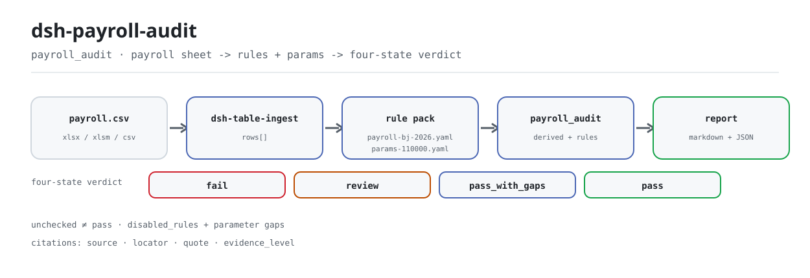

<div align="center">

<picture>
  <source media="(prefers-color-scheme: dark)" srcset="docs/assets/dsh-payroll-audit-flow-dark.svg">
  
</picture>

# dsh-payroll-audit

**पेरोल शीट को प्रकाशित सामाजिक बीमा, हाउसिंग फंड और आयकर पैरामीटर पर पंक्ति-दर-पंक्ति जाँचें — हर अंतर के साथ कारण, धारा और राशि।**

DeepSeek Harness के लिए पेरोल ऑडिट प्लगइन, पेरोल, मानव संसाधन और वित्त के लिए: एक पेरोल शीट दें और यह हर पंक्ति में योगदान आधार, दरें, बीमा कवरेज, सकल-से-शुद्ध गणना और संचयी रोक जाँचता है। जो पैरामीटर कभी प्राप्त नहीं हुआ, उसे अपरिप्रमाणित बताया जाता है — «जाँचा नहीं गया» को कभी «अनुपालन» नहीं कहा जाता।

[इंस्टॉल](#तीन-चरणों-में-शुरुआत) · [कॉन्फ़िगरेशन](#कॉन्फ़िगरेशन) · [FAQ](#faq) · [简体中文](README.md) · [English](README.en.md) · [Español](README.es.md) · [Português](README.pt.md) · [हिन्दी](README.hi.md)

[](LICENSE)
[](#संगतता)
[](https://www.npmjs.com/package/dsh-payroll-audit)
[](https://github.com/PerryLink/dsh-payroll-audit/actions/workflows/ci.yml)
[](#संगतता)

[](https://github.com/PerryLink/dsh-payroll-audit/stargazers)
[](https://www.npmjs.com/package/dsh-payroll-audit)
[](https://dshfind.com/plugins/PerryLink/dsh-payroll-audit?ref=badge)
[](https://securityscorecards.dev/viewer/?uri=github.com/PerryLink/dsh-payroll-audit)
[](https://gitee.com/perrylink/dsh-payroll-audit)

```sh
dsh plugin --profile <name> add dsh-payroll-audit
```

</div>

<sub>सामुदायिक प्लगइन, DeepSeek से असंबद्ध। कैनोनिकल रिपॉज़िटरी: <https://github.com/PerryLink/dsh-payroll-audit> (Gitee एक मिरर है)।</sub>

## यह क्या है

एक पेरोल शीट (एक व्यक्ति = एक पंक्ति) दें और `dsh-payroll-audit` अपने नियम पैक से हर पंक्ति के योगदान, कटौतियाँ और शुद्ध वेतन निकालता है, फिर उन्हें प्रकाशित सामाजिक बीमा, हाउसिंग फंड और आयकर पैरामीटर से मिलाता है: घोषित आधार शहर की न्यूनतम और अधिकतम सीमा के भीतर है?, योगदान आधार × प्रकाशित दर के बराबर है?, शुद्ध वेतन सकल में से कटौतियाँ घटाकर निकलता है?, संचयी रोक सही ढंग से पुनर्गणना होती है? हर अंतर के साथ `reason_code`, गंभीरता, प्रभाव राशि और धारा का उद्धरण आता है।

निर्णय जानबूझकर चार स्थितियों में है: `pass`, `pass_with_gaps`, `review`, `fail`। जिस नियम का पैरामीटर कभी प्राप्त नहीं हुआ, वह नियम पैक में `disabled_rules` में रहता है — चलता नहीं, पर रिपोर्ट में सूचीबद्ध रहता है, इसलिए «कोई अंतर नहीं मिला» कभी «अनुपालन» के रूप में नहीं दिखाया जाता। पैरामीटर अपनी `valid_from` / `valid_to` वैधता अवधि से हल होते हैं; अवधि के बाहर का मान खाली हल होता है, और नियम पिछले साल के आँकड़े से निर्णय लेने के बजाय अपरिप्रमाणित हो जाता है।

यह केवल अंकगणित और फ़ील्ड-संगति की जाँच है: कुछ दाखिल नहीं करता, सामाजिक बीमा एजेंसी के निर्धारण का विकल्प नहीं है, और रोज़गार संबंध तय नहीं करता।

## तीन चरणों में शुरुआत

1. **इंस्टॉल करें** (npm प्रकाशित है; git और tarball चैनल वैकल्पिक हैं):

   ```sh
   # npm चैनल (प्रकाशित रिलीज़)
   dsh plugin --profile web add dsh-payroll-audit
   # git चैनल (नवीनतम main)
   dsh plugin --profile web add github:PerryLink/dsh-payroll-audit
   # tarball चैनल: इस रेपो में pnpm pack करके
   dsh plugin --profile web add ./dsh-payroll-audit-<version>.tgz
   ```

   git चैनल `prepare` (`tsdown`) से `lib/` बनाता है; npm पैकेज और tarball में `lib/` पहले से है।

2. **न्यूनतम कॉन्फ़िग** (डिफ़ॉल्ट से ही चलता है; `cordis.patch.yml` पहले से bundle पंक्ति डालता है):

   ```yaml
   - insert:
       - id: dsh-payroll-audit
         name: dsh-payroll-audit
   ```

3. **जाँचें कि काम कर रहा है** (साथ दिया नमूना बीजिंग 2026-07 की 3-पंक्ति पेरोल है):

   ```sh
   node samples/quickstart/run.mjs --check
   ```

   ```text
   payroll_audit: quickstart OK — output matches expected/result.json
   ```

   नमूने में 3 पंक्तियाँ, 2 अंतर, 15 अपरिप्रमाणित मदें और 4 पैरामीटर अंतराल हैं; अपेक्षित परिणाम `samples/quickstart/expected/result.json` में है।

**अनइंस्टॉल**: `dsh plugin --profile web remove dsh-payroll-audit` (या प्रोफ़ाइल patch से पंक्ति हटाएँ)।

## मुख्य क्षमताएँ

- **प्रति पंक्ति चार-स्थिति निर्णय** — `fail` / `review` / `pass_with_gaps` / `pass`। जिस पंक्ति में कोई नियम नहीं चला, वह कभी `pass` नहीं हो सकती।
- **नियम पैक डेटा हैं** — `rules/payroll-bj-2026.yaml` (17 नियम, 28 व्युत्पन्न कॉलम) और `rules/payroll-sh-2026.yaml` (7 नियम)। व्युत्पन्न कॉलम व्हाइटलिस्ट अंकगणितीय अभिव्यक्तियाँ हैं (`round`, `min`, `max`, `nz`, `sum`, `abs`, `bracket_rate`); पार्सर होस्ट स्कोप को नहीं छूता और `eval` नहीं है।
- **पैरामीटर न मिले तो नियम बंद** — पैरामीटर दस्तावेज़ में `pending` घोषित प्रविष्टियाँ अपने नियमों को `disabled_rules` में डाल देती हैं; रिपोर्ट में पैरामीटर अंतराल और उन्हें खोलने की शर्तें सूचीबद्ध होती हैं। अनुपस्थित मान खाली हल होता है, 0 नहीं।
- **प्रभाव राशि** — हर सक्रिय नियम प्रभाव निकालता है; उदाहरण के लिए न्यूनतम सीमा से नीचे आधार पर कम योगदान दिखाता है: `(7270 − 7000) × (16% + 8% + 2 × 0.5%) = 67.50`।
- **सत्यापन-योग्य उद्धरण** — हर नियम में `cite` है; उद्धरण तालिका स्रोत, लोकेटर और उद्धरण देती है, और `check:citations` एक अलग गेट है।
- **स्प्रेडशीट सीधे पढ़ता है** — `dsh-table-ingest` से `.xlsx` / `.xlsm` / `.csv`; कन्वर्ज़न चरण नहीं।

### यह किन सवालों का जवाब देता है

- घोषित योगदान आधार उस अवधि के लिए शहर की न्यूनतम और अधिकतम सीमा के भीतर है?
- योगदान राशि आधार × प्रकाशित दर के बराबर है?
- शुद्ध वेतन सकल में से कटौतियाँ घटाकर निकलता है?
- कौन से नियम इसलिए नहीं चले कि पैरामीटर कभी प्राप्त नहीं हुआ?

### किससे मिलान होता है

हर नियम में उद्धरण हैं; उद्धरण तालिका स्रोत, लोकेटर और उद्धरण देती है (जो शब्दशः पाठ नहीं मिला वह `paraphrase` या `pending` चिह्नित है, साथ में खोलने की शर्त):

- बीजिंग सामाजिक बीमा आधार सीमाएँ: बीजिंग नगर मानव संसाधन और सामाजिक सुरक्षा ब्यूरो की 2026 अधिसूचना (7,270 / 36,348)।
- बीजिंग हाउसिंग फंड: 5%–12%, आधार 2,540–36,348।
- शंघाई: आधार सीमाएँ 7,546 / 37,731, हाउसिंग फंड **5%–7%** — राष्ट्रीय विनियम के 5%–12% नहीं, इसलिए यह सीमा पैरामीटर फ़ाइल से पढ़ी जाती है, हार्डकोड नहीं; पूरक हाउसिंग फंड 1%–5%।
- आयकर: संचयी रोक, राज्य कर प्रशासन की 2018 अधिसूचना संख्या 61 के अनुसार।

अलग साक्ष्य निर्देशिका नहीं है: उद्धरण नियम पैक में, उस नियम के पास रहते हैं जो उन्हें इस्तेमाल करता है। पैरामीटर डॉट-कुंजियों से संबोधित होते हैं (जैसे `si.base.floor`, `hf.fund.employee_max`) और आधिकारिक पैरामीटर दस्तावेज़ से हल होते हैं; दस्तावेज़ में स्वयं `next_review_by` होता है, जिसे रिपोर्ट हेडर दिखाता है।

### इनपुट प्रारूप

पेरोल शीट एक तालिका है जिसमें प्रति व्यक्ति एक पंक्ति होती है। पैक जो फ़ील्ड पढ़ते हैं उनमें शामिल हैं:

| फ़ील्ड | अर्थ |
|---|---|
| `period` | `2026-07`; पैरामीटर की वैधता अवधि चुनता है |
| `base_declared` | घोषित योगदान आधार (CNY/माह), महीने का सकल नहीं |
| `gross_pay`, `net_pay` | सकल और शुद्ध वेतन |
| `employer_pension`, `employee_pension` | भुगतान की गई पेंशन (नियोक्ता / कर्मचारी) |
| `ee_unemployment`, `ee_medical`, `ee_hf` | कर्मचारी पक्ष का बेरोज़गारी, चिकित्सा और हाउसिंग फंड |
| `hf_base`, `hf_employer_rate`, `hf_employee_rate` | हाउसिंग फंड इनपुट |
| `insurance_set` | नामांकित योजनाएँ, कॉमा से अलग |
| `person_type` | वैकल्पिक; `rehired_retiree` / `intern` आदि बदलते हैं कौन से आधार नियम लागू हों |
| `iit_withheld`, `cum_*`, `overtime_*`, `prior_base` | आयकर, ओवरटाइम और समायोजन नियम मौजूद होने पर पढ़ते हैं |

फ़ाइल `dsh-table-ingest` से पढ़ी जाती है, इसलिए `.xlsx`, `.xlsm` और `.csv` सभी काम करते हैं।

### टूल सतह

| सतह | अर्थ |
|---|---|
| `payroll_audit` | एकमात्र पंजीकृत टूल, `output.schema` और Markdown प्रोजेक्शन के साथ |
| `file` | पेरोल शीट का निरपेक्ष पथ (`.xlsx` / `.xlsm` / `.csv`) |
| `period` | पेरोल अवधि, जैसे `2026-07`; न दें तो शीट का `period` कॉलम |
| `rulePackFile` / `paramsFile` | प्रति कॉल कॉन्फ़िगर किए गए नियम पैक / पैरामीटर फ़ाइल को ओवरराइड करें |
| `timeoutMs` | टूल टाइमआउट बजट, कॉन्फ़िग से |

### उदाहरण

```text
$ node samples/quickstart/run.mjs
payroll_audit: 3 rows, 2 finding(s) — fail 2, review 0, pass_with_gaps 1, pass 0
unchecked items: 15; parameter gaps: 4
```

*Observed from `samples/quickstart/run.mjs:59-66`; expected summary in `samples/quickstart/expected/result.json`.*

## कॉन्फ़िगरेशन

हर ट्यून करने योग्य चीज़ Schemastery `Config` फ़ील्ड है (`src/config.ts` देखें), `cordis.yml` से ओवरराइड हो सकती है; दोनों पथ कुंजियाँ पैकेज रूट के सापेक्ष हल होती हैं। `id` से ओवरराइड पूरी पंक्ति बदल देता है, इसलिए सभी आवश्यक कुंजियाँ दोहराएँ।

| कुंजी | डिफ़ॉल्ट | अर्थ |
|---|---|---|
| `timeoutMs` | `120000` | `payroll_audit` टूल का टाइमआउट बजट (मिलीसेकंड) |
| `rulePackFile` | `rules/payroll-bj-2026.yaml` | नियम पैक पथ; शंघाई के लिए `rules/payroll-sh-2026.yaml` |
| `paramsFile` | `rules/params-110000.yaml` | पैरामीटर दस्तावेज़ पथ; शंघाई के लिए `rules/params-310000.yaml` |

प्रोफ़ाइल patch ओवरराइड उदाहरण:

```yaml
- insert:
    - id: dsh-payroll-audit
      name: dsh-payroll-audit
      config:
        rulePackFile: rules/payroll-sh-2026.yaml
        paramsFile: rules/params-310000.yaml
```

## FAQ

<details>
<summary>पैरामीटर न मिले तो क्या होता है? चुपचाप शून्य मान लेता है?</summary>

नहीं। पैरामीटर दस्तावेज़ अनुपलब्ध दर या मानक को `pending` घोषित करता है और उससे अवरुद्ध नियमों की सूची देता है; वे नियम `disabled_rules` में जाते हैं, कभी नहीं चलते, पर रिपोर्ट के «अपरिप्रमाणित (अनुपालन का प्रमाण नहीं)» भाग में दिखते हैं। मान खाली हल होता है, 0 नहीं, इसलिए उस पर निर्भर कोई भी व्युत्पन्न कॉलम नहीं बन सकता, नियम `skipped` हो जाता है, और पंक्ति अधिकतम `pass_with_gaps` रहती है।

</details>

<details>
<summary>डेटा कहाँ रहता है? कुछ अपलोड होता है या मॉडल को भेजा जाता है?</summary>

प्लगइन केवल वही पेरोल फ़ाइल पढ़ता है जो आप कॉल में देते हैं: मूल फ़ाइल को वापस नहीं लिखता, कैश नहीं बनाता, नेटवर्क अनुरोध नहीं करता और किसी मॉडल को नहीं बुलाता। पूरी गणना स्थानीय है। टूल परिणाम (रिपोर्ट पाठ सहित) किसी भी टूल की तरह DSH सत्र रिकॉर्ड में जाते हैं, इसलिए अपने डेटा वर्गीकरण के अनुसार तय करें कि वास्तविक पेरोल शीट सत्र में जानी चाहिए या नहीं।

</details>

<details>
<summary>क्या यह अन्य प्लगइनों के टूल नाम, सेवाओं या इवेंट से टकराएगा?</summary>

यह ठीक एक टूल `payroll_audit` पंजीकृत करता है, `inject: ['tools']` के साथ; कोई सेवा कुंजी नहीं देता, क्लाइंट slot नहीं, `webServer` prefix नहीं, साझा इवेंट नहीं सुनता और वैश्विक ऑब्जेक्ट नहीं बदलता। एकमात्र साझा सतह टूल का नाम है: यदि कोई दूसरा प्लगइन भी नंगा नाम `payroll_audit` पंजीकृत करता है, तो DSH टूल पंजीकरण टकराएगा — यह नामकरण परंपरा का मुद्दा है, छिपा दुष्प्रभाव नहीं।

</details>

<details>
<summary>प्रदर्शन लागत कितनी है?</summary>

शुद्ध स्थानीय अंकगणित: प्रति पंक्ति पैक के व्युत्पन्न कॉलम निकालता है, फिर हर नियम जाँचता है; बीजिंग पैक में 17 नियम और 28 व्युत्पन्न कॉलम हैं, कोई नेटवर्क या मॉडल कॉल नहीं। डिफ़ॉल्ट टाइमआउट बजट `120000` मिलीसेकंड है, जो कुछ सौ पंक्तियों की पेरोल के लिए बहुत अधिक है।

</details>

<details>
<summary>इंस्टॉल हो गया पर टूल नहीं दिखता, या `dsh plugin add` पैकेज अस्वीकार करता है?</summary>

पहले पुष्टि करें कि `pnpm run build` ने `lib/index.mjs` बनाया (`package.json#main` उसी की ओर इशारा करता है); फिर पुष्टि करें कि होस्ट संस्करण `>=0.2.1-0 <0.3.0` के भीतर है। पैकेज अस्वीकार होना आम तौर पर peer रेंज के मेल न खाने का संकेत है; पुराना DSH कोर ज़बरदस्ती न इंस्टॉल करें। जब कोई नियम न चले, तो रिपोर्ट का «अपरिप्रमाणित» भाग और टूल के `uncheckedCount` व `parameterGaps` पढ़ें।

</details>

## सुरक्षा सीमाएँ

- **जाँचता है, निर्णय नहीं देता।** यह अंकगणित और फ़ील्ड-संगति की जाँच है, न दाखिला, न ऑडिट राय, न रोज़गार संबंध का निर्धारण; कुछ जमा नहीं करता, सामाजिक बीमा एजेंसी के निर्धारण का विकल्प नहीं है, और नहीं बताता कि किसी व्यक्ति का नामांकन होना चाहिए या नहीं।
- **अपरिप्रमाणित ≠ अनुपालन।** पैरामीटर या फ़ील्ड न मिलने पर नियम नहीं चलता और «अपरिप्रमाणित» तथा «पैरामीटर अंतराल» में सूचीबद्ध होता है; `pass_with_gaps`, `pass` नहीं है। रिपोर्ट कहती है «जाँची गई मदों में कोई अंतर नहीं मिला», कभी «अनुपालन» नहीं।
- **फ़ेल-क्लोज़्ड।** गलत पैरामीटर schema, नियम की स्थिति में `field` / `op` की कमी, खाली `rules` सूची, या एक ही नियम का `rules` और `disabled_rules` दोनों में होना — सब लोड के समय त्रुटि देते हैं, चुपचाप नहीं निकलते।
- **इनपुट केवल-पढ़ें।** टूल दिए गए पथ को पढ़ता है; कभी वापस नहीं लिखता और सुधरी हुई पेरोल शीट नहीं बनाता।
- **कोई मनगढ़ंत उद्धरण नहीं।** उद्धरण तालिका `source`, `locator` और `quote` देती है; जिन धाराओं का शब्दशः पाठ नहीं मिला, वे स्पष्ट रूप से `paraphrase` या `pending` चिह्नित हैं, साथ में खोलने की शर्त।
- **रनटाइम में नेटवर्क नहीं, मॉडल कॉल नहीं।** एकमात्र रनटाइम निर्भरता `dsh-table-ingest` है, शीट पढ़ने के लिए।

## ज्ञात सीमाएँ

- **सीमित शहर और अवधि।** केवल बीजिंग (`110000`) और शंघाई (`310000`) के 2026-07 से पैक हैं; पहले की अवधियों में पैरामीटर नहीं, इसलिए नियम अपरिप्रमाणित हो जाते हैं। एक पैक एक शहर के लिए है — दूसरे शहर के लिए `rulePackFile` / `paramsFile` बदलें या कॉल में ओवरराइड करें।
- **बंद जाँचें।** चिकित्सा, मातृत्व, चोट-दर श्रेणियाँ और न्यूनतम वेतन बंद हैं क्योंकि प्राथमिक दर या मानक नहीं मिला: बीजिंग में 3 नियम, शंघाई में 4 नियम बंद; रिपोर्ट हर कारण और खोलने की शर्त बताती है।
- **मिश्रित प्रमाण स्तर।** बीजिंग सामाजिक बीमा सीमाएँ, बीजिंग हाउसिंग फंड, शंघाई सीमाएँ और शंघाई हाउसिंग फंड शब्दशः उद्धरण हैं; शंघाई पेंशन और बेरोज़गारी दरें अभी `paraphrase` हैं, इसलिए वे नियम पैक में बंद हैं; आयकर स्लैब मान भी `paraphrase` हैं और रिलीज़ से पहले शब्दशः उद्धरण चाहिए। संचयी रोक सूत्र राज्य कर प्रशासन की 2018 की अधिसूचना संख्या 61, अनुच्छेद 6 का उद्धरण देता है।
- **नियम भाषा केवल `when.all_of` समर्थित करती है।** इंजन अन्य शर्त रूपों को स्पष्ट रूप से अस्वीकार करता है; गलत पैक लोड के समय विफल होता है।
- **YAML रीडर रेपो-आंतरिक सबसेट पार्सर है**, पूर्ण YAML कार्यान्वयन नहीं; पैक और पैरामीटर दस्तावेज़ उसी सबसेट में रहते हैं।
- **सुधरी हुई पेरोल शीट नहीं बनती**, कोई दाखिला दस्तावेज़ नहीं बनता, और अनुपालन निष्कर्ष नहीं दिया जाता।
- **राशि सहनशीलता 1.00 CNY**, दरें राशियों से उलटकर निकाली जाती हैं, और राउंडिंग फ़ेन तक हाफ-अप है (पैक में `round_half_up_to_fen` घोषित)।
- **शीट में अवधि चाहिए।** यदि `period` कॉलम नहीं है, तो कॉल में `period` दें (जैसे `2026-07`); अन्यथा टूल त्रुटि देता है।

## अन्य DSH प्लगइनों के साथ इंटरऑपरेबिलिटी

प्लगइन एक टूल, `payroll_audit`, पंजीकृत करता है और `inject: ['tools']` से `tools` सेवा की प्रतीक्षा करता है; कोई सेवा कुंजी नहीं देता, क्लाइंट slot नहीं, `webServer` prefix नहीं, साझा इवेंट नहीं सुनता और वैश्विक ऑब्जेक्ट नहीं बदलता। इसलिए टूल नाम के अलावा किसी साझा सतह के लिए प्रतिस्पर्धा नहीं करता, और किसी दूसरे प्लगइन की कॉल श्रृंखला को काट नहीं सकता।

नियम पैक और पैरामीटर दस्तावेज़ पैकेज के `rules/` के नीचे सादा YAML हैं, जिन्हें अन्य टूल पढ़ या बना सकते हैं; प्लगइन अपने बाहर के रनटाइम स्टेट पर निर्भर नहीं है। एकमात्र नामकरण जोखिम नंगा टूल नाम `payroll_audit` है: यदि दूसरा प्लगइन वही नाम पंजीकृत करता है, तो DSH पंजीकरण टकराएगा।

## संगतता

| आयाम | स्थिति |
|---|---|
| Harness | `engines.dsh` है `>=0.2.1-0 <0.3.0`; peer `@deepseek-ai/dsh-tools` `0.1.x` और `0.2.x` कवर करता है |
| Node | `^22.19.0 \|\| >=24.0.0` |
| प्लेटफ़ॉर्म | जहाँ DSH चले (शुद्ध ESM, मूल कोड नहीं, नेटवर्क नहीं, मॉडल कॉल नहीं) |
| इनपुट | `.xlsx` / `.xlsm` / `.csv` (`dsh-table-ingest` से) |
| सत्यापन | `pnpm test` 25/25 (`ACCEPTANCE.csv` में दर्ज) |

## इकोसिस्टम और गुणवत्ता

- [Gitee मिरर](https://gitee.com/perrylink/dsh-payroll-audit) (समन्वित मिरर; GitHub कैनोनिकल है)
- [dshfind प्लगइन पृष्ठ](https://dshfind.com/plugins/PerryLink/dsh-payroll-audit) (इंस्टॉल और रैंकिंग)
- [OpenSSF Scorecard रिपोर्ट](https://securityscorecards.dev/viewer/?uri=github.com/PerryLink/dsh-payroll-audit) ([.github/workflows/scorecard.yml](.github/workflows/scorecard.yml) द्वारा संचालित)

## डेवलपमेंट

```sh
pnpm install
pnpm run typecheck
pnpm test
pnpm run build
pnpm run verify:self-contained
pnpm run check:lockfile
pnpm run check:readmes
pnpm run check:citations
pnpm pack
```

संरचना:

| पथ | सामग्री |
|---|---|
| `src/index.ts` | फ़ंक्शन-प्लगइन प्रवेश: `payroll_audit` पंजीकृत करता है, पैक और पैरामीटर पथ हल करता है |
| `src/config.ts` | Schemastery `Config`: `timeoutMs` / `rulePackFile` / `paramsFile` |
| `src/engine.ts` | शुद्ध ऑडिट कोर: व्युत्पन्न कॉलम, नियम मूल्यांकन, चार-स्थिति निर्णय |
| `src/expr.ts` | प्रतिबंधित अभिव्यक्ति पार्सर और मूल्यांकन (व्हाइटलिस्ट AST) |
| `src/params.ts` | पैरामीटर लोडिंग: डॉटेड कुंजियाँ, वैधता अवधि, अंतराल और स्रोत |
| `src/report.ts` | रिपोर्ट रेंडरिंग: पहले अपरिप्रमाणित, फिर अंतर |
| `src/shared/` | रेपो-आंतरिक साझा किट: YAML सबसेट, ruleset, तालिका और शब्द-गार्ड |
| `rules/` | दो नियम पैक, दो पैरामीटर दस्तावेज़, उद्धरण बेसलाइन |
| `samples/quickstart/` | 3-पंक्ति बीजिंग नमूना, अपेक्षित परिणाम, `--check` स्क्रिप्ट |
| `tests/` | vitest: नियम, पैरामीटर, अभिव्यक्तियाँ और सीमा अर्थशास्त्र |
| `scripts/` | चार गेट: self-contained, lockfile, README सिंक, उद्धरण |
| `docs/assets/` | README चित्र और डेमो सामग्री |

चित्र [`scripts/gen-readme-assets.py`](scripts/gen-readme-assets.py) से बनते हैं (Python; केवल कमांड token वाला हल्का/गहरा SVG जोड़ा, पाँचों भाषाएँ साझा करती हैं)। दोबारा चलाएँ: `python scripts/gen-readme-assets.py`.

Topics: `dsh`, `dsh-plugin`, `deepseek-harness`, `deepseek`, `cordis`, `payroll`, `social`

## परिवार और आभार

यह परियोजना [PerryLink](https://github.com/PerryLink) द्वारा अनुरक्षित DeepSeek Harness प्लगइन परिवार की सदस्य है (सभी Apache-2.0)। पूरा सूचकांक [सामग्री के अनुसार चेकर चुनें](https://perrylink.github.io/zh/checkers/choose/) और [सभी प्लगइन](https://github.com/PerryLink) पर है। अगर इस प्लगइन ने मदद की, तो **एक स्टार दें** — इससे कोई सुविधा नहीं खुलती, पर अगला व्यक्ति इसे आसानी से ढूँढ पाता है।

- [@PerryLink](https://github.com/PerryLink) — निर्माता और अनुरक्षक: नियम इंजन, दो-शहर पैरामीटर पुस्तकालय, नियम पैक और पाँच-भाषा दस्तावेज़।

<details>
<summary>सभी प्लगइन दिखाएँ</summary>

| प्लगइन | स्थिति |
|---|---|
| **[dsh-aqua-input-check](https://github.com/PerryLink/dsh-aqua-input-check)** | |
| **[dsh-archive-check](https://github.com/PerryLink/dsh-archive-check)** | |
| **[dsh-auto-review](https://github.com/PerryLink/dsh-auto-review)** | |
| **[dsh-autotier](https://github.com/PerryLink/dsh-autotier)** | 🧊 फ़्रोज़न — रेपो README देखें |
| **[dsh-bid-ca-precheck](https://github.com/PerryLink/dsh-bid-ca-precheck)** | |
| **[dsh-bid-qual-check](https://github.com/PerryLink/dsh-bid-qual-check)** | |
| **[dsh-cert-mcp](https://github.com/PerryLink/dsh-cert-mcp)** | 🧊 फ़्रोज़न — रेपो README देखें |
| **[dsh-checkpoint-rewind](https://github.com/PerryLink/dsh-checkpoint-rewind)** | |
| **[dsh-click](https://github.com/PerryLink/dsh-click)** | |
| **[dsh-composer-history](https://github.com/PerryLink/dsh-composer-history)** | |
| **[dsh-contract-stance](https://github.com/PerryLink/dsh-contract-stance)** | |
| **[dsh-customs-doc-check](https://github.com/PerryLink/dsh-customs-doc-check)** | |
| **[dsh-data-quality](https://github.com/PerryLink/dsh-data-quality)** | 🧊 फ़्रोज़न — रेपो README देखें |
| **[dsh-demurrage-ledger](https://github.com/PerryLink/dsh-demurrage-ledger)** | |
| **[dsh-doublecheck](https://github.com/PerryLink/dsh-doublecheck)** | |
| **[dsh-drill-script-check](https://github.com/PerryLink/dsh-drill-script-check)** | |
| **[dsh-eia-guide-check](https://github.com/PerryLink/dsh-eia-guide-check)** | |
| **[dsh-emergency-plan](https://github.com/PerryLink/dsh-emergency-plan)** | |
| **[dsh-essay-rubric-check](https://github.com/PerryLink/dsh-essay-rubric-check)** | |
| **[dsh-evidence-check](https://github.com/PerryLink/dsh-evidence-check)** | |
| **[dsh-export-ctl-check](https://github.com/PerryLink/dsh-export-ctl-check)** | |
| **[dsh-fast](https://github.com/PerryLink/dsh-fast)** | |
| **[dsh-fmea-table-check](https://github.com/PerryLink/dsh-fmea-table-check)** | |
| **[dsh-forecast-penalty](https://github.com/PerryLink/dsh-forecast-penalty)** | |
| **[dsh-fund-research](https://github.com/PerryLink/dsh-fund-research)** | |
| **[dsh-github](https://github.com/PerryLink/dsh-github)** | |
| **[dsh-gongwen-flow-check](https://github.com/PerryLink/dsh-gongwen-flow-check)** | |
| **[dsh-gongwen-word-check](https://github.com/PerryLink/dsh-gongwen-word-check)** | |
| **[dsh-guard-plan-qc](https://github.com/PerryLink/dsh-guard-plan-qc)** | |
| **[dsh-hazchem-check](https://github.com/PerryLink/dsh-hazchem-check)** | |
| **[dsh-hazplan-check](https://github.com/PerryLink/dsh-hazplan-check)** | |
| **[dsh-hidden-risk-map](https://github.com/PerryLink/dsh-hidden-risk-map)** | |
| **[dsh-hs-classify](https://github.com/PerryLink/dsh-hs-classify)** | |
| **[dsh-icd-rule-check](https://github.com/PerryLink/dsh-icd-rule-check)** | |
| **[dsh-industry-research](https://github.com/PerryLink/dsh-industry-research)** | |
| **[dsh-lawcite-adapter](https://github.com/PerryLink/dsh-lawcite-adapter)** | |
| **[dsh-laya](https://github.com/PerryLink/dsh-laya)** | |
| **[dsh-lc-doc-check](https://github.com/PerryLink/dsh-lc-doc-check)** | |
| **[dsh-learning-gap-check](https://github.com/PerryLink/dsh-learning-gap-check)** | |
| **[dsh-library](https://github.com/PerryLink/dsh-library)** | |
| **[dsh-local-ai](https://github.com/PerryLink/dsh-local-ai)** | |
| **[dsh-lsp-actions](https://github.com/PerryLink/dsh-lsp-actions)** | |
| **[dsh-mask](https://github.com/PerryLink/dsh-mask)** | |
| **[dsh-mcp-panel](https://github.com/PerryLink/dsh-mcp-panel)** | |
| **[dsh-medrec-qc](https://github.com/PerryLink/dsh-medrec-qc)** | |
| **[dsh-memento](https://github.com/PerryLink/dsh-memento)** | 🧊 फ़्रोज़न — रेपो README देखें |
| **[dsh-nsfc-form-check](https://github.com/PerryLink/dsh-nsfc-form-check)** | |
| **[dsh-nurse-record-check](https://github.com/PerryLink/dsh-nurse-record-check)** | |
| **[dsh-observe](https://github.com/PerryLink/dsh-observe)** | |
| **[dsh-origin-rvc-check](https://github.com/PerryLink/dsh-origin-rvc-check)** | |
| **[dsh-ota-review-check](https://github.com/PerryLink/dsh-ota-review-check)** | |
| **[dsh-output-styles](https://github.com/PerryLink/dsh-output-styles)** | |
| **[dsh-paper-doc-adapter](https://github.com/PerryLink/dsh-paper-doc-adapter)** | |
| **[dsh-permission-rules](https://github.com/PerryLink/dsh-permission-rules)** | |
| **[dsh-permit-report-check](https://github.com/PerryLink/dsh-permit-report-check)** | |
| **[dsh-pipeline-check](https://github.com/PerryLink/dsh-pipeline-check)** | |
| **[dsh-pleading-draft](https://github.com/PerryLink/dsh-pleading-draft)** | |
| **[dsh-plugin-doctor](https://github.com/PerryLink/dsh-plugin-doctor)** | 🚫 रिटायर्ड (रेपो संग्रहीत) |
| **[dsh-plugin-guide](https://github.com/PerryLink/dsh-plugin-guide)** | |
| **[dsh-plugin-kit](https://github.com/PerryLink/dsh-plugin-kit)** | 🚫 रिटायर्ड (रेपो संग्रहीत) |
| **[dsh-plugin-upgrade](https://github.com/PerryLink/dsh-plugin-upgrade)** | 🚫 रिटायर्ड (रेपो संग्रहीत) |
| **[dsh-policy-brief-draft](https://github.com/PerryLink/dsh-policy-brief-draft)** | |
| **[dsh-power-loss-split](https://github.com/PerryLink/dsh-power-loss-split)** | |
| **[dsh-power-ticket-check](https://github.com/PerryLink/dsh-power-ticket-check)** | |
| **[dsh-ppap-check](https://github.com/PerryLink/dsh-ppap-check)** | |
| **[dsh-protest-deadline](https://github.com/PerryLink/dsh-protest-deadline)** | |
| **[dsh-railway-window](https://github.com/PerryLink/dsh-railway-window)** | |
| **[dsh-repair-order-qc](https://github.com/PerryLink/dsh-repair-order-qc)** | |
| **[dsh-research-report](https://github.com/PerryLink/dsh-research-report)** | |
| **[dsh-review-reply-check](https://github.com/PerryLink/dsh-review-reply-check)** | |
| **[dsh-rulefile-check](https://github.com/PerryLink/dsh-rulefile-check)** | |
| **[dsh-safety-brief-check](https://github.com/PerryLink/dsh-safety-brief-check)** | |
| **[dsh-score](https://github.com/PerryLink/dsh-score)** | 🧊 फ़्रोज़न — रेपो README देखें |
| **[dsh-session-sync](https://github.com/PerryLink/dsh-session-sync)** | |
| **[dsh-site-log-check](https://github.com/PerryLink/dsh-site-log-check)** | |
| **[dsh-skill-pack-security](https://github.com/PerryLink/dsh-skill-pack-security)** | |
| **[dsh-soe-decision-check](https://github.com/PerryLink/dsh-soe-decision-check)** | |
| **[dsh-soilwater-check](https://github.com/PerryLink/dsh-soilwater-check)** | |
| **[dsh-sop-sync-check](https://github.com/PerryLink/dsh-sop-sync-check)** | |
| **[dsh-spc-gbt-adapter](https://github.com/PerryLink/dsh-spc-gbt-adapter)** | |
| **[dsh-talk](https://github.com/PerryLink/dsh-talk)** | |
| **[dsh-tender-extract](https://github.com/PerryLink/dsh-tender-extract)** | |
| **[dsh-tender-matrix](https://github.com/PerryLink/dsh-tender-matrix)** | |
| **[dsh-test-drive](https://github.com/PerryLink/dsh-test-drive)** | |
| **[dsh-ticktick](https://github.com/PerryLink/dsh-ticktick)** | 🚫 रिटायर्ड (रेपो संग्रहीत) |
| **[dsh-translate](https://github.com/PerryLink/dsh-translate)** | |
| **[dsh-warranty-calc](https://github.com/PerryLink/dsh-warranty-calc)** | |
| **[dsh-budget](https://github.com/PerryLink/dsh-budget)** | |
| **[dsh-claude-move](https://github.com/PerryLink/dsh-claude-move)** | |
| **[dsh-defend](https://github.com/PerryLink/dsh-defend)** | |
| **[dsh-draw](https://github.com/PerryLink/dsh-draw)** | 🧊 फ़्रोज़न — रेपो README देखें |
| **[dsh-reach](https://github.com/PerryLink/dsh-reach)** | |
| **[dsh-background-agents](https://github.com/PerryLink/dsh-background-agents)** | 🚫 रिटायर्ड (रेपो संग्रहीत) |
| **[dsh-session-pin](https://github.com/PerryLink/dsh-session-pin)** | 🚫 रिटायर्ड (रेपो संग्रहीत) |
| **[dsh-team-rooms](https://github.com/PerryLink/dsh-team-rooms)** | 🚫 रिटायर्ड (रेपो संग्रहीत) |

</details>

## लाइसेंस

[LICENSE](LICENSE) (Apache License 2.0) © 2026 dsh-payroll-audit contributors

<p align="center"><sub>Apache-2.0 · सामुदायिक प्लगइन, DeepSeek से असंबद्ध।</sub></p>
