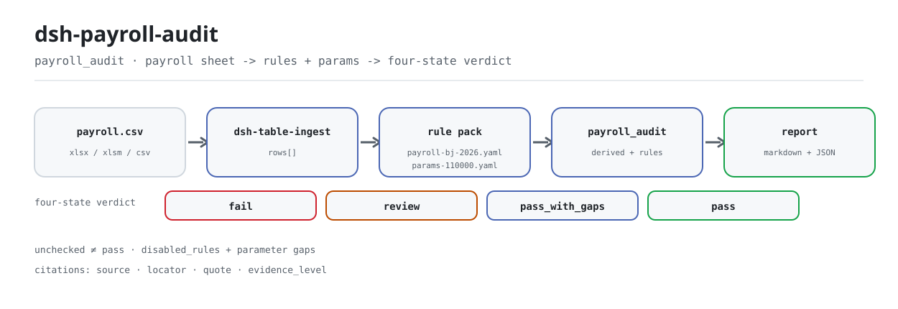

<div align="center">

<picture>
  <source media="(prefers-color-scheme: dark)" srcset="docs/assets/dsh-payroll-audit-flow-dark.svg">
  
</picture>

# dsh-payroll-audit

**把工资表逐条核到已公开的社保、公积金与个税参数上——差异、依据与金额一次说清。**

面向 DeepSeek Harness 的算薪核对插件，给薪酬、人事与财务用：读一张工资表，逐行核对缴费基数、费率、险种、应发实发勾稽与个税累计预扣；参数没取到就明确标为未核验，绝不把「没查」写成「合规」。

[安装](#三步上手) · [配置](#配置) · [FAQ](#faq) · [简体中文](README.md) · [English](README.en.md) · [Español](README.es.md) · [Português](README.pt.md) · [हिन्दी](README.hi.md)

[](LICENSE)
[](#兼容性)
[](https://www.npmjs.com/package/dsh-payroll-audit)
[](https://github.com/PerryLink/dsh-payroll-audit/actions/workflows/ci.yml)
[](#兼容性)

[](https://github.com/PerryLink/dsh-payroll-audit/stargazers)
[](https://www.npmjs.com/package/dsh-payroll-audit)
[](https://dshfind.com/plugins/PerryLink/dsh-payroll-audit?ref=badge)
[](https://securityscorecards.dev/viewer/?uri=github.com/PerryLink/dsh-payroll-audit)
[](https://gitee.com/perrylink/dsh-payroll-audit)

```sh
dsh plugin --profile <name> add dsh-payroll-audit
```

</div>

<sub>社区插件，与 DeepSeek 官方无关。唯一仓库：<https://github.com/PerryLink/dsh-payroll-audit>（Gitee 为镜像）。</sub>

## 它是什么

给它一张工资表（一人一行），`dsh-payroll-audit` 就按规则包逐行算出应缴、应扣与应发，再拿已公开的社保、公积金与个税参数逐条比对：申报基数是否落在城市上下限内、缴费金额是否等于基数乘已公布费率、应发减扣款是否等于实发、个税累计预扣是否重算得上。每条差异都带 `reason_code`、严重度、影响金额和条款引文。

结论刻意做成四态：`pass`、`pass_with_gaps`、`review`、`fail`。参数没取到的规则在规则包里就是 `disabled_rules`——不执行、但逐条列进报告，所以「没发现问题」永远不会被渲染成「合规」。参数按 `valid_from` / `valid_to` 的生效窗口解析，窗口之外的值解析为空，规则转入未核验，而不是拿旧数字下判断。

它只做算术与字段一致性核对：不代申报、不替代社保经办机构核定、不判断用工关系。

## 三步上手

1. **安装**（npm 已发布；git 与 tarball 通道按需）：

   ```sh
   # npm 通道（已发布版本）
   dsh plugin --profile web add dsh-payroll-audit
   # git 通道（最新 main）
   dsh plugin --profile web add github:PerryLink/dsh-payroll-audit
   # tarball 通道：本仓库 pnpm pack 后
   dsh plugin --profile web add ./dsh-payroll-audit-<version>.tgz
   ```

   git 通道由 `prepare` 触发 `tsdown` 构建；npm 包与 tarball 已带 `lib/`。

2. **最小配置**（默认值即可用；`cordis.patch.yml` 已插入 bundle 行）：

   ```yaml
   - insert:
       - id: dsh-payroll-audit
         name: dsh-payroll-audit
   ```

3. **验证已生效**（自带样例是 3 行北京 2026-07 工资表）：

   ```sh
   node samples/quickstart/run.mjs --check
   ```

   ```text
   payroll_audit: quickstart OK — output matches expected/result.json
   ```

   样例输出为 3 行、2 条差异、15 个未核验项、4 个参数缺口；期望结果在 `samples/quickstart/expected/result.json`。

**卸载**：`dsh plugin --profile web remove dsh-payroll-audit`（或从 profile patch 删掉该行）。

## 核心能力

- **逐行四态结论** —— `fail` / `review` / `pass_with_gaps` / `pass`。只要有规则没执行，这一行就最多是 `pass_with_gaps`，永远到不了 `pass`。
- **规则包是数据** —— `rules/payroll-bj-2026.yaml`（17 条规则、28 个派生列）与 `rules/payroll-sh-2026.yaml`（7 条规则）。派生列是白名单算术表达式（`round`、`min`、`max`、`nz`、`sum`、`abs` 与 `bracket_rate`），解析器不接触宿主作用域，无 `eval`。
- **参数缺失即停用** —— 参数文件里 `pending` 的项把对应规则关进 `disabled_rules`，报告列出参数缺口与解封条件；缺失值解析为空，不是 0。
- **影响金额** —— 每条命中规则算出影响，例如基数低于下限时报少缴金额：`(7270 − 7000) × (16% + 8% + 2 × 0.5%) = 67.50`。
- **引文可核** —— 每条规则带 `cite`，引用表给出出处、定位与引文；`check:citations` 是独立门禁。
- **表格直读** —— 经 `dsh-table-ingest` 读 `.xlsx` / `.xlsm` / `.csv`，不要求先转格式。

### 它回答什么

- 申报的缴费基数是否落在该城市该期间的上下限内？
- 缴费金额是否等于基数乘以已公布的费率？
- 实发是否等于应发减去各项扣款？
- 哪些规则因为参数没取到而根本没能执行？

### 核对依据

每条规则都带引文，引用表给出出处、定位与引文（取不到逐字原文的标 `paraphrase` 或 `pending`，并写明解封条件）：

- 北京社保基数上下限：北京市人社局 2026 年度通告（7,270 / 36,348）。
- 北京公积金：5%–12%，基数 2,540–36,348。
- 上海：基数上下限 7,546 / 37,731，公积金 **5%–7%**——不是国家条例的 5%–12%，所以区间从参数文件读，不写死；另有补充公积金 1%–5%。
- 个税：累计预扣法，依国家税务总局公告 2018 年第 61 号。

没有独立取证目录：引文就在规则包里，紧挨着使用它的规则。参数用点号键寻址（如 `si.base.floor`、`hf.fund.employee_max`），从官方参数文件解析；参数文件自带 `next_review_by`，报告抬头会显示复核截止日。

### 输入格式

工资表是一人一行的表格，规则包读取的字段包括：

| 字段 | 含义 |
|---|---|
| `period` | `2026-07`；用于选择参数的生效区间 |
| `base_declared` | 申报的缴费基数（元/月），不是当月应发 |
| `gross_pay`、`net_pay` | 应发与实发 |
| `employer_pension`、`employee_pension` | 实际缴纳的养老（单位 / 个人） |
| `ee_unemployment`、`ee_medical`、`ee_hf` | 个人侧失业、医疗与公积金 |
| `hf_base`、`hf_employer_rate`、`hf_employee_rate` | 公积金输入 |
| `insurance_set` | 参保险种，逗号分隔 |
| `person_type` | 可选；`rehired_retiree` / `intern` 等会改变基数规则的适用 |
| `iit_withheld`、`cum_*`、`overtime_*`、`prior_base` | 个税累计、加班与补差规则按需读取 |

文件经由 `dsh-table-ingest` 读取，因此 `.xlsx`、`.xlsm`、`.csv` 都支持。

### 工具面

| 表面 | 说明 |
|---|---|
| `payroll_audit` | 唯一注册的工具，带 `output.schema` 与 Markdown 投影 |
| `file` | 工资表绝对路径（`.xlsx` / `.xlsm` / `.csv`） |
| `period` | 工资所属期，如 `2026-07`；缺省读表里的 `period` 列 |
| `rulePackFile` / `paramsFile` | 单次调用覆盖配置里的规则包 / 参数文件 |
| `timeoutMs` | 工具超时预算，来自配置 |

### 示例

```text
$ node samples/quickstart/run.mjs
payroll_audit: 3 rows, 2 finding(s) — fail 2, review 0, pass_with_gaps 1, pass 0
unchecked items: 15; parameter gaps: 4
```

*Observed from `samples/quickstart/run.mjs:59-66`; expected summary in `samples/quickstart/expected/result.json`.*

## 配置

所有可调项都是 Schemastery `Config` 字段（见 `src/config.ts`），可从 `cordis.yml` 覆盖；两个路径键相对包根解析。改配置按 `id` 覆盖会替换整行，请重述需要的键。

| 键 | 默认值 | 含义 |
|---|---|---|
| `timeoutMs` | `120000` | `payroll_audit` 工具的超时预算（毫秒） |
| `rulePackFile` | `rules/payroll-bj-2026.yaml` | 规则包路径；切上海用 `rules/payroll-sh-2026.yaml` |
| `paramsFile` | `rules/params-110000.yaml` | 参数文件路径；上海对应 `rules/params-310000.yaml` |

profile patch 覆盖示例：

```yaml
- insert:
    - id: dsh-payroll-audit
      name: dsh-payroll-audit
      config:
        rulePackFile: rules/payroll-sh-2026.yaml
        paramsFile: rules/params-310000.yaml
```

## FAQ

<details>
<summary>参数没取到会怎样？会不会静默按 0 算？</summary>

不会。参数文件把未取得的费率或标准声明为 `pending`，并列出被它阻塞的规则；这些规则进入 `disabled_rules`，整个执行期都不跑，但会出现在报告的「未核验项（不代表合规）」里。参数值本身解析为空而不是 0，所以依赖它的派生列算不出来，规则转为 `skipped`，这一行最多是 `pass_with_gaps`。

</details>

<details>
<summary>数据存在哪？会不会上传或发给模型？</summary>

插件只打开调用时给你的那个工资表文件读取，不写回原件、不建缓存、不发网络请求、不调用模型。计算全在本地完成；工具结果（含报告文本）会进入 DSH 的会话记录，这与任何工具一致，所以请按你的数据分级决定是否把真实工资表交给会话。

</details>

<details>
<summary>会和其他插件抢工具名、服务或事件吗？</summary>

只注册一个工具 `payroll_audit`，`inject: ['tools']`；不提供服务键、不注册客户端 slot、不注册 `webServer` 前缀、不监听共享事件、不改全局对象。唯一的共享表面是工具名本身：若另一个插件也注册裸名 `payroll_audit`，DSH 的工具注册会冲突——这是命名约定问题，不是隐式副作用。

</details>

<details>
<summary>性能开销多大？</summary>

纯本地算术：每行先算规则包声明的派生列，再逐条判定规则；北京包是 17 条规则、28 个派生列，没有网络与模型调用。默认超时预算是 `120000` 毫秒，正常一张几百行的工资表远用不到。

</details>

<details>
<summary>装上了但工具不出现，或 `dsh plugin add` 拒绝这个包？</summary>

先确认 `pnpm run build` 产出了 `lib/index.mjs`（`package.json#main` 指向它）；再确认宿主版本落在 `>=0.2.1-0 <0.3.0`。包被拒通常是 peer 范围不匹配，不要强行装旧版 DSH 核心。规则没执行时，读报告里的「未核验项」与工具返回的 `uncheckedCount`、`parameterGaps`。

</details>

## 安全边界

- **只核对，不裁决。** 这是算术与字段一致性核对，不是申报、不是审计意见，也不判断用工关系；它不提交任何东西，不替代社保经办机构核定，也不告诉你某个人该不该参保。
- **未核验 ≠ 合规。** 参数未取得或字段缺失时，对应规则不执行，并在「未核验项」与「参数缺口」中列出；`pass_with_gaps` 不等于 `pass`。报告措辞只说「已核验项未发现差异」，不说「合规」。
- **失败关闭。** 参数文件 schema 不对、规则包条件缺 `field` / `op`、`rules` 为空、同一规则同时出现在 `rules` 与 `disabled_rules`，都在加载期抛错，不静默放过。
- **输入只读。** 工具只读取给定的文件路径，不写回、不生成更正后的工资表。
- **引文不伪造。** 引用表逐条给出 `source`、`locator`、`quote`；取不到逐字原文的条款在规则包里明确标为 `paraphrase` 或 `pending`，并写明解封条件。
- **运行期无网络、无模型调用。** 运行时依赖只有读表用的 `dsh-table-ingest`。

## 已知限制

- **城市与期间有限。** 只带北京（`110000`）与上海（`310000`）2026-07 起的包；更早期间没有参数，规则降级为未核验。每个规则包只对应一个城市，跨城市要切换 `rulePackFile` / `paramsFile` 或在调用时覆盖。
- **停用的检查。** 医疗、生育、工伤行业档次、最低工资因未取得一手费率或标准而停用：北京停用 3 条规则、上海停用 4 条，报告逐条列出原因与解封条件。
- **证据等级有高有低。** 北京社保基数、北京公积金、上海基数与上海公积金是逐字引文；上海养老费率与失业费率仍标为 `paraphrase`，对应规则在包里关闭；个税税率表数值同样标为 `paraphrase`，发布前需补逐字引文。个税累计预扣公式引国家税务总局公告 2018 年第 61 号第六条。
- **规则语言只支持 `when.all_of`。** 引擎明确拒绝其他条件形态；规则包写错会在加载期报错。
- **YAML 读取是仓内子集解析器**，不是完整 YAML 实现；规则包与参数文件只使用该子集。
- **不计算更正后的工资表**，不生成申报文件，不提供合规结论。
- **金额容差 1.00 元**，比例按金额倒推；四舍五入到分（规则包声明 `round_half_up_to_fen`）。
- **输入表需要所属期。** 表里没有 `period` 列时，调用必须传 `period`（形如 `2026-07`），否则工具直接报错。

## 与其他 DSH 插件的互操作性

本插件只注册一个工具 `payroll_audit`，通过 `inject: ['tools']` 等待 `tools` 服务；不提供任何服务键、不注册客户端 slot、不注册 `webServer` 前缀、不监听共享事件、不改写全局对象。因此它不参与工具名以外的任何共享表面争用，也不会短路其他插件的调用链。

规则包与参数文件是普通 YAML 数据，放在包内 `rules/` 下，可被其他工具读取或生成；插件不依赖自身之外的运行时状态。唯一的命名风险是裸工具名 `payroll_audit`：如果另一个插件注册了同名工具，DSH 的注册会冲突。

## 兼容性

| 维度 | 状态 |
|---|---|
| Harness | `engines.dsh` 为 `>=0.2.1-0 <0.3.0`；peer 依赖 `@deepseek-ai/dsh-tools` 覆盖 `0.1.x` 与 `0.2.x` |
| Node | `^22.19.0 \|\| >=24.0.0` |
| 平台 | 任何 DSH 可运行处（纯 ESM、无原生代码、无网络、无模型调用） |
| 输入 | `.xlsx` / `.xlsm` / `.csv`（经 `dsh-table-ingest`） |
| 验证 | `pnpm test` 25/25（`ACCEPTANCE.csv` 记录） |

## 生态与质量

- [Gitee 镜像](https://gitee.com/perrylink/dsh-payroll-audit)（同步镜像，以 GitHub 为准）
- [dshfind 插件页](https://dshfind.com/plugins/PerryLink/dsh-payroll-audit)（安装量与排名）
- [OpenSSF Scorecard 报告](https://securityscorecards.dev/viewer/?uri=github.com/PerryLink/dsh-payroll-audit)（由 [.github/workflows/scorecard.yml](.github/workflows/scorecard.yml) 驱动）

## 开发

```sh
pnpm install
pnpm run typecheck
pnpm test
pnpm run build
pnpm run verify:self-contained
pnpm run check:lockfile
pnpm run check:readmes
pnpm run check:citations
pnpm pack
```

目录布局：

| 路径 | 内容 |
|---|---|
| `src/index.ts` | 函数插件入口：注册 `payroll_audit`，解析规则包与参数路径 |
| `src/config.ts` | Schemastery `Config`：`timeoutMs` / `rulePackFile` / `paramsFile` |
| `src/engine.ts` | 纯核对核心：派生列、规则判定、四态结论 |
| `src/expr.ts` | 受限算术表达式解析与求值（白名单 AST） |
| `src/params.ts` | 参数文件加载：点号键、生效窗口、参数缺口与出处 |
| `src/report.ts` | 报告渲染：先列未核验项，再列差异明细 |
| `src/shared/` | 仓内共享件：YAML 子集、规则集、表格与措辞守卫 |
| `rules/` | 两个规则包与两份参数文件、引文基线 |
| `samples/quickstart/` | 3 行北京样例、期望结果、`--check` 脚本 |
| `tests/` | vitest：规则、参数、表达式与边界语义 |
| `scripts/` | 自包含、锁文件、README 同步、引文四项门禁 |
| `docs/assets/` | README 配图与演示素材 |

配图由 [`scripts/gen-readme-assets.py`](scripts/gen-readme-assets.py) 程序化生成（Python，输出深/浅两版 SVG，图内只放命令 token，五语共用）。复跑：`python scripts/gen-readme-assets.py`。

Topics：`dsh`, `dsh-plugin`, `deepseek-harness`, `deepseek`, `cordis`, `payroll`, `social`

## 家族与致谢

本项目是 [PerryLink](https://github.com/PerryLink) 维护的 DeepSeek Harness 插件家族成员（全部 Apache-2.0）。完整清单见[按材料选核查器](https://perrylink.github.io/zh/checkers/choose/)与[全部插件](https://github.com/PerryLink)。如果这个插件帮到了你，**给个 star**——它不解锁任何功能，但会让下一个人更容易找到它。

- [@PerryLink](https://github.com/PerryLink) —— 创建者与维护者：规则引擎、两城参数库、规则包与五语文档。

<details>
<summary>展开全部插件</summary>

| 插件 | 状态 |
|---|---|
| **[dsh-aqua-input-check](https://github.com/PerryLink/dsh-aqua-input-check)** | |
| **[dsh-archive-check](https://github.com/PerryLink/dsh-archive-check)** | |
| **[dsh-auto-review](https://github.com/PerryLink/dsh-auto-review)** | |
| **[dsh-autotier](https://github.com/PerryLink/dsh-autotier)** | 🧊 已冻结 — 见仓库 README |
| **[dsh-bid-ca-precheck](https://github.com/PerryLink/dsh-bid-ca-precheck)** | |
| **[dsh-bid-qual-check](https://github.com/PerryLink/dsh-bid-qual-check)** | |
| **[dsh-cert-mcp](https://github.com/PerryLink/dsh-cert-mcp)** | 🧊 已冻结 — 见仓库 README |
| **[dsh-checkpoint-rewind](https://github.com/PerryLink/dsh-checkpoint-rewind)** | |
| **[dsh-click](https://github.com/PerryLink/dsh-click)** | |
| **[dsh-composer-history](https://github.com/PerryLink/dsh-composer-history)** | |
| **[dsh-contract-stance](https://github.com/PerryLink/dsh-contract-stance)** | |
| **[dsh-customs-doc-check](https://github.com/PerryLink/dsh-customs-doc-check)** | |
| **[dsh-data-quality](https://github.com/PerryLink/dsh-data-quality)** | 🧊 已冻结 — 见仓库 README |
| **[dsh-demurrage-ledger](https://github.com/PerryLink/dsh-demurrage-ledger)** | |
| **[dsh-doublecheck](https://github.com/PerryLink/dsh-doublecheck)** | |
| **[dsh-drill-script-check](https://github.com/PerryLink/dsh-drill-script-check)** | |
| **[dsh-eia-guide-check](https://github.com/PerryLink/dsh-eia-guide-check)** | |
| **[dsh-emergency-plan](https://github.com/PerryLink/dsh-emergency-plan)** | |
| **[dsh-essay-rubric-check](https://github.com/PerryLink/dsh-essay-rubric-check)** | |
| **[dsh-evidence-check](https://github.com/PerryLink/dsh-evidence-check)** | |
| **[dsh-export-ctl-check](https://github.com/PerryLink/dsh-export-ctl-check)** | |
| **[dsh-fast](https://github.com/PerryLink/dsh-fast)** | |
| **[dsh-fmea-table-check](https://github.com/PerryLink/dsh-fmea-table-check)** | |
| **[dsh-forecast-penalty](https://github.com/PerryLink/dsh-forecast-penalty)** | |
| **[dsh-fund-research](https://github.com/PerryLink/dsh-fund-research)** | |
| **[dsh-github](https://github.com/PerryLink/dsh-github)** | |
| **[dsh-gongwen-flow-check](https://github.com/PerryLink/dsh-gongwen-flow-check)** | |
| **[dsh-gongwen-word-check](https://github.com/PerryLink/dsh-gongwen-word-check)** | |
| **[dsh-guard-plan-qc](https://github.com/PerryLink/dsh-guard-plan-qc)** | |
| **[dsh-hazchem-check](https://github.com/PerryLink/dsh-hazchem-check)** | |
| **[dsh-hazplan-check](https://github.com/PerryLink/dsh-hazplan-check)** | |
| **[dsh-hidden-risk-map](https://github.com/PerryLink/dsh-hidden-risk-map)** | |
| **[dsh-hs-classify](https://github.com/PerryLink/dsh-hs-classify)** | |
| **[dsh-icd-rule-check](https://github.com/PerryLink/dsh-icd-rule-check)** | |
| **[dsh-industry-research](https://github.com/PerryLink/dsh-industry-research)** | |
| **[dsh-lawcite-adapter](https://github.com/PerryLink/dsh-lawcite-adapter)** | |
| **[dsh-laya](https://github.com/PerryLink/dsh-laya)** | |
| **[dsh-lc-doc-check](https://github.com/PerryLink/dsh-lc-doc-check)** | |
| **[dsh-learning-gap-check](https://github.com/PerryLink/dsh-learning-gap-check)** | |
| **[dsh-library](https://github.com/PerryLink/dsh-library)** | |
| **[dsh-local-ai](https://github.com/PerryLink/dsh-local-ai)** | |
| **[dsh-lsp-actions](https://github.com/PerryLink/dsh-lsp-actions)** | |
| **[dsh-mask](https://github.com/PerryLink/dsh-mask)** | |
| **[dsh-mcp-panel](https://github.com/PerryLink/dsh-mcp-panel)** | |
| **[dsh-medrec-qc](https://github.com/PerryLink/dsh-medrec-qc)** | |
| **[dsh-memento](https://github.com/PerryLink/dsh-memento)** | 🧊 已冻结 — 见仓库 README |
| **[dsh-nsfc-form-check](https://github.com/PerryLink/dsh-nsfc-form-check)** | |
| **[dsh-nurse-record-check](https://github.com/PerryLink/dsh-nurse-record-check)** | |
| **[dsh-observe](https://github.com/PerryLink/dsh-observe)** | |
| **[dsh-origin-rvc-check](https://github.com/PerryLink/dsh-origin-rvc-check)** | |
| **[dsh-ota-review-check](https://github.com/PerryLink/dsh-ota-review-check)** | |
| **[dsh-output-styles](https://github.com/PerryLink/dsh-output-styles)** | |
| **[dsh-paper-doc-adapter](https://github.com/PerryLink/dsh-paper-doc-adapter)** | |
| **[dsh-permission-rules](https://github.com/PerryLink/dsh-permission-rules)** | |
| **[dsh-permit-report-check](https://github.com/PerryLink/dsh-permit-report-check)** | |
| **[dsh-pipeline-check](https://github.com/PerryLink/dsh-pipeline-check)** | |
| **[dsh-pleading-draft](https://github.com/PerryLink/dsh-pleading-draft)** | |
| **[dsh-plugin-doctor](https://github.com/PerryLink/dsh-plugin-doctor)** | 🚫 已退役（仓库已归档） |
| **[dsh-plugin-guide](https://github.com/PerryLink/dsh-plugin-guide)** | |
| **[dsh-plugin-kit](https://github.com/PerryLink/dsh-plugin-kit)** | 🚫 已退役（仓库已归档） |
| **[dsh-plugin-upgrade](https://github.com/PerryLink/dsh-plugin-upgrade)** | 🚫 已退役（仓库已归档） |
| **[dsh-policy-brief-draft](https://github.com/PerryLink/dsh-policy-brief-draft)** | |
| **[dsh-power-loss-split](https://github.com/PerryLink/dsh-power-loss-split)** | |
| **[dsh-power-ticket-check](https://github.com/PerryLink/dsh-power-ticket-check)** | |
| **[dsh-ppap-check](https://github.com/PerryLink/dsh-ppap-check)** | |
| **[dsh-protest-deadline](https://github.com/PerryLink/dsh-protest-deadline)** | |
| **[dsh-railway-window](https://github.com/PerryLink/dsh-railway-window)** | |
| **[dsh-repair-order-qc](https://github.com/PerryLink/dsh-repair-order-qc)** | |
| **[dsh-research-report](https://github.com/PerryLink/dsh-research-report)** | |
| **[dsh-review-reply-check](https://github.com/PerryLink/dsh-review-reply-check)** | |
| **[dsh-rulefile-check](https://github.com/PerryLink/dsh-rulefile-check)** | |
| **[dsh-safety-brief-check](https://github.com/PerryLink/dsh-safety-brief-check)** | |
| **[dsh-score](https://github.com/PerryLink/dsh-score)** | 🧊 已冻结 — 见仓库 README |
| **[dsh-session-sync](https://github.com/PerryLink/dsh-session-sync)** | |
| **[dsh-site-log-check](https://github.com/PerryLink/dsh-site-log-check)** | |
| **[dsh-skill-pack-security](https://github.com/PerryLink/dsh-skill-pack-security)** | |
| **[dsh-soe-decision-check](https://github.com/PerryLink/dsh-soe-decision-check)** | |
| **[dsh-soilwater-check](https://github.com/PerryLink/dsh-soilwater-check)** | |
| **[dsh-sop-sync-check](https://github.com/PerryLink/dsh-sop-sync-check)** | |
| **[dsh-spc-gbt-adapter](https://github.com/PerryLink/dsh-spc-gbt-adapter)** | |
| **[dsh-talk](https://github.com/PerryLink/dsh-talk)** | |
| **[dsh-tender-extract](https://github.com/PerryLink/dsh-tender-extract)** | |
| **[dsh-tender-matrix](https://github.com/PerryLink/dsh-tender-matrix)** | |
| **[dsh-test-drive](https://github.com/PerryLink/dsh-test-drive)** | |
| **[dsh-ticktick](https://github.com/PerryLink/dsh-ticktick)** | 🚫 已退役（仓库已归档） |
| **[dsh-translate](https://github.com/PerryLink/dsh-translate)** | |
| **[dsh-warranty-calc](https://github.com/PerryLink/dsh-warranty-calc)** | |
| **[dsh-budget](https://github.com/PerryLink/dsh-budget)** | |
| **[dsh-claude-move](https://github.com/PerryLink/dsh-claude-move)** | |
| **[dsh-defend](https://github.com/PerryLink/dsh-defend)** | |
| **[dsh-draw](https://github.com/PerryLink/dsh-draw)** | 🧊 已冻结 — 见仓库 README |
| **[dsh-reach](https://github.com/PerryLink/dsh-reach)** | |
| **[dsh-background-agents](https://github.com/PerryLink/dsh-background-agents)** | 🚫 已退役（仓库已归档） |
| **[dsh-session-pin](https://github.com/PerryLink/dsh-session-pin)** | 🚫 已退役（仓库已归档） |
| **[dsh-team-rooms](https://github.com/PerryLink/dsh-team-rooms)** | 🚫 已退役（仓库已归档） |

</details>

## License

[LICENSE](LICENSE)（Apache License 2.0）© 2026 dsh-payroll-audit contributors

<p align="center"><sub>Apache-2.0 · 社区插件，与 DeepSeek 无关。</sub></p>
