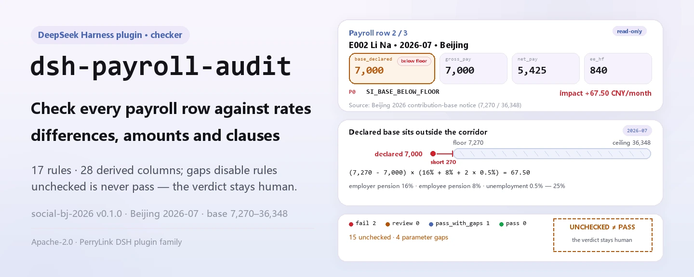
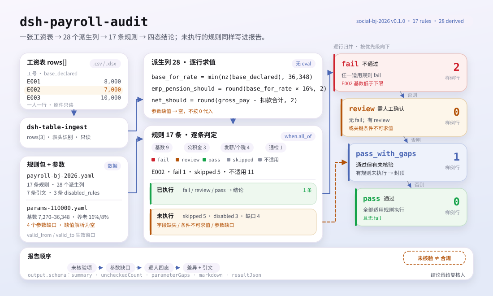

<div align="center">

<picture>
  <source media="(prefers-color-scheme: dark)" srcset="docs/assets/dsh-payroll-audit-hero-en-dark.webp">
  
</picture>

# dsh-payroll-audit

**Confira uma folha de pagamento linha por linha contra parâmetros publicados de previdência, fundo de garantia e imposto de renda — cada diferença com motivo, cláusula e valor.**

Um plugin de auditoria de folha de pagamento para o DeepSeek Harness, feito para folha, RH e finanças: você entrega uma folha e ele confere em cada linha a base de contribuição, as alíquotas, a cobertura de seguros, a conta bruto-líquido e a retenção acumulada. Parâmetro que nunca foi obtido é reportado como não verificado: «não conferido» nunca é apresentado como «em conformidade».

[Instalar](#instalação-em-três-passos) · [Configuração](#configuração) · [FAQ](#faq) · [简体中文](README.md) · [English](README.en.md) · [Español](README.es.md) · [Português](README.pt.md) · [हिन्दी](README.hi.md)

[](LICENSE)
[](#compatibilidade)
[](https://www.npmjs.com/package/dsh-payroll-audit)
[](https://github.com/PerryLink/dsh-payroll-audit/actions/workflows/ci.yml)
[](#compatibilidade)

[](https://github.com/PerryLink/dsh-payroll-audit/stargazers)
[](https://www.npmjs.com/package/dsh-payroll-audit)
[](https://dshfind.com/plugins/PerryLink/dsh-payroll-audit?ref=badge)
[](https://securityscorecards.dev/viewer/?uri=github.com/PerryLink/dsh-payroll-audit)
[](https://gitee.com/perrylink/dsh-payroll-audit)

```sh
dsh plugin --profile <name> add dsh-payroll-audit
```

</div>

<sub>Plugin da comunidade, sem afiliação com a DeepSeek. Repositório canônico: <https://github.com/PerryLink/dsh-payroll-audit> (o Gitee é um espelho).</sub>

## O que é

Entregue uma folha de pagamento (uma linha por pessoa) e o `dsh-payroll-audit` calcula em cada linha as contribuições, os descontos e o líquido a partir do seu pacote de regras, e então compara com parâmetros publicados de previdência, fundo de garantia e imposto de renda: a base declarada está dentro do piso e do teto da cidade?, a contribuição equivale à base vezes a alíquota publicada?, o líquido decorre do bruto menos os descontos?, a retenção acumulada recalcula corretamente? Cada diferença traz `reason_code`, severidade, valor de impacto e citação da cláusula.

O veredito é deliberadamente de quatro estados: `pass`, `pass_with_gaps`, `review`, `fail`. Uma regra cujo parâmetro nunca foi obtido fica em `disabled_rules`: não roda, mas continua aparecendo no relatório, de modo que «sem achados» nunca é apresentado como «em conformidade». Os parâmetros são resolvidos pela janela `valid_from` / `valid_to`; um valor fora da janela resolve como vazio, e a regra passa a não verificada em vez de decidir com o número do ano passado.

Ele só confere aritmética e consistência de campos: não transmite nada, não substitui a apuração do órgão gestor e não determina a relação de trabalho.

<picture>
  <source media="(prefers-color-scheme: dark)" srcset="docs/assets/dsh-payroll-audit-flow-v5-dark.svg">
  
</picture>

## Instalação em três passos

1. **Instale** (o npm está publicado; os canais git e tarball são opcionais):

   ```sh
   # canal npm (versões publicadas)
   dsh plugin --profile web add dsh-payroll-audit
   # canal git (último main)
   dsh plugin --profile web add github:PerryLink/dsh-payroll-audit
   # canal tarball: pnpm pack neste repo e depois
   dsh plugin --profile web add ./dsh-payroll-audit-<version>.tgz
   ```

   O canal git constrói `lib/` via `prepare` (`tsdown`); o pacote npm e o tarball já trazem `lib/`.

2. **Configuração mínima** (os padrões já funcionam; o `cordis.patch.yml` já insere a linha do bundle):

   ```yaml
   - insert:
       - id: dsh-payroll-audit
         name: dsh-payroll-audit
   ```

3. **Verifique que funciona** (o exemplo incluído é uma folha de Pequim de 2026-07 com 3 linhas):

   ```sh
   node samples/quickstart/run.mjs --check
   ```

   ```text
   payroll_audit: quickstart OK — output matches expected/result.json
   ```

   O exemplo dá 3 linhas, 2 diferenças, 15 itens não verificados e 4 lacunas de parâmetros; o resultado esperado está em `samples/quickstart/expected/result.json`.

**Desinstalar**: `dsh plugin --profile web remove dsh-payroll-audit` (ou remova a linha do patch do perfil).

## Capacidades principais

- **Veredito de quatro estados por linha** — `fail` / `review` / `pass_with_gaps` / `pass`. Uma linha com qualquer regra não executada nunca pode ser `pass`.
- **Os pacotes de regras são dados** — `rules/payroll-bj-2026.yaml` (17 regras, 28 colunas derivadas) e `rules/payroll-sh-2026.yaml` (7 regras). As colunas derivadas são expressões aritméticas de lista branca (`round`, `min`, `max`, `nz`, `sum`, `abs`, `bracket_rate`); o analisador não toca o escopo do host e não há `eval`.
- **Parâmetro ausente desativa a regra** — entradas declaradas `pending` no documento de parâmetros levam suas regras para `disabled_rules`; o relatório lista as lacunas e o que as desbloquearia. Um valor ausente resolve como vazio, não como 0.
- **Valores de impacto** — cada regra que dispara calcula o impacto; por exemplo, base abaixo do piso informa a contribuição faltante: `(7270 − 7000) × (16% + 8% + 2 × 0.5%) = 67.50`.
- **Citações verificáveis** — cada regra traz `cite`; a tabela de citações dá fonte, localizador e citação, e `check:citations` é uma porta separada.
- **Lê planilhas diretamente** — `.xlsx` / `.xlsm` / `.csv` via `dsh-table-ingest`, sem etapa de conversão.

### O que responde

- A base declarada está dentro do piso e do teto da cidade para o período?
- Os valores de contribuição equivalem à base vezes a alíquota publicada?
- O líquido decorre do bruto menos os descontos?
- Quais regras não puderam rodar porque o parâmetro nunca foi obtido?

### Com o que se compara

Cada regra traz citações; a tabela de citações dá fonte, localizador e citação (o texto literal que não foi obtido é marcado `paraphrase` ou `pending`, com o que o desbloquearia):

- Limites de base da previdência de Pequim: aviso de 2026 da Secretaria Municipal de Recursos Humanos e Seguridade Social de Pequim (7.270 / 36.348).
- Fundo de garantia de Pequim: 5%–12%, base 2.540–36.348.
- Xangai: limites de base 7.546 / 37.731, fundo de garantia **5%–7%** — não os 5%–12% do regulamento nacional, por isso o intervalo é lido do arquivo de parâmetros e não codificado; fundo de garantia complementar 1%–5%.
- Imposto de renda: retenção acumulada conforme o Anúncio n.º 61 de 2018 da Administração Tributária Estatal.

Não há diretório de evidências separado: as citações ficam no pacote de regras, ao lado da regra que as usa. Os parâmetros são endereçados por chaves com pontos (como `si.base.floor`, `hf.fund.employee_max`) e resolvidos a partir do documento oficial de parâmetros; o documento traz o próprio `next_review_by`, que o cabeçalho do relatório mostra.

### Formato de entrada

Uma folha de pagamento é uma tabela com uma linha por pessoa. Os campos que os pacotes leem incluem:

| Campo | Significado |
|---|---|
| `period` | `2026-07`; seleciona a janela de vigência dos parâmetros |
| `base_declared` | Base de contribuição declarada (CNY/mês), não o bruto do mês |
| `gross_pay`, `net_pay` | Bruto e líquido |
| `employer_pension`, `employee_pension` | Contribuições de previdência pagas (empregador / empregado) |
| `ee_unemployment`, `ee_medical`, `ee_hf` | Desemprego, saúde e fundo de garantia do lado do empregado |
| `hf_base`, `hf_employer_rate`, `hf_employee_rate` | Entradas do fundo de garantia |
| `insurance_set` | Seguros contratados, separados por vírgulas |
| `person_type` | Opcional; `rehired_retiree` / `intern` etc. mudam quais regras de base se aplicam |
| `iit_withheld`, `cum_*`, `overtime_*`, `prior_base` | Lidos pelas regras de imposto, horas extras e regularização quando existem |

O arquivo é lido via `dsh-table-ingest`, então `.xlsx`, `.xlsm` e `.csv` funcionam.

### Superfície da ferramenta

| Superfície | Significado |
|---|---|
| `payroll_audit` | A única ferramenta registrada, com `output.schema` e projeção Markdown |
| `file` | Caminho absoluto da folha de pagamento (`.xlsx` / `.xlsm` / `.csv`) |
| `period` | Período da folha, p. ex. `2026-07`; por padrão, a coluna `period` da planilha |
| `rulePackFile` / `paramsFile` | Substituição por chamada do pacote de regras / documento de parâmetros configurado |
| `timeoutMs` | Orçamento de timeout da ferramenta, vindo da configuração |

### Exemplo

```text
$ node samples/quickstart/run.mjs
payroll_audit: 3 rows, 2 finding(s) — fail 2, review 0, pass_with_gaps 1, pass 0
unchecked items: 15; parameter gaps: 4
```

*Observed from `samples/quickstart/run.mjs:59-66`; expected summary in `samples/quickstart/expected/result.json`.*

## Configuração

Tudo o que é ajustável é um campo Schemastery `Config` (ver `src/config.ts`), sobrescrevível a partir de `cordis.yml`; as duas chaves de caminho resolvem em relação à raiz do pacote. Sobrescrever por `id` substitui a linha inteira, então repita todas as chaves necessárias.

| Chave | Valor padrão | Significado |
|---|---|---|
| `timeoutMs` | `120000` | Orçamento de timeout da ferramenta `payroll_audit` em milissegundos |
| `rulePackFile` | `rules/payroll-bj-2026.yaml` | Caminho do pacote de regras; para Xangai use `rules/payroll-sh-2026.yaml` |
| `paramsFile` | `rules/params-110000.yaml` | Caminho do documento de parâmetros; Xangai usa `rules/params-310000.yaml` |

Exemplo de sobrescrita no patch do perfil:

```yaml
- insert:
    - id: dsh-payroll-audit
      name: dsh-payroll-audit
      config:
        rulePackFile: rules/payroll-sh-2026.yaml
        paramsFile: rules/params-310000.yaml
```

## FAQ

<details>
<summary>O que acontece se um parâmetro não foi obtido? Usa zero em silêncio?</summary>

Não. O documento de parâmetros declara a alíquota ou o padrão ausente como `pending` e lista as regras que ele bloqueia; essas regras vão para `disabled_rules`, nunca rodam e aparecem na seção «não verificado (não é prova de conformidade)» do relatório. O valor resolve como vazio, não como 0, então qualquer coluna derivada que dependa dele não pode ser calculada, a regra fica `skipped` e a linha é no máximo `pass_with_gaps`.

</details>

<details>
<summary>Onde ficam os dados? Algo é enviado ou vai para um modelo?</summary>

O plugin apenas lê o arquivo de folha que você passa na chamada: não regrava o original, não cria cache, não faz requisições de rede e não chama modelo. Todo o cálculo é local. Os resultados da ferramenta (incluindo o texto do relatório) entram no registro de sessão do DSH como os de qualquer ferramenta, então decida conforme a classificação dos seus dados se uma folha real deve entrar numa sessão.

</details>

<details>
<summary>Vai conflitar com nomes de ferramentas, serviços ou eventos de outros plugins?</summary>

Registra exatamente uma ferramenta, `payroll_audit`, com `inject: ['tools']`; não fornece chaves de serviço, não registra slots de cliente, nem prefixo `webServer`, não escuta eventos compartilhados e não altera objetos globais. A única superfície compartilhada é o nome da ferramenta: se outro plugin também registrar o nome nu `payroll_audit`, o registro de ferramentas do DSH vai conflitar — é uma questão de convenção de nomes, não um efeito colateral oculto.

</details>

<details>
<summary>Qual é o custo de desempenho?</summary>

Aritmética local pura: por linha avalia as colunas derivadas do pacote e depois testa cada regra; o pacote de Pequim tem 17 regras e 28 colunas derivadas, sem rede nem chamadas a modelos. O orçamento de timeout padrão é `120000` ms, muito mais do que uma folha de algumas centenas de linhas precisa.

</details>

<details>
<summary>Instala mas a ferramenta não aparece, ou `dsh plugin add` rejeita o pacote?</summary>

Primeiro confirme que `pnpm run build` gerou `lib/index.mjs` (é para lá que `package.json#main` aponta); depois confirme que a versão do host está dentro de `>=0.2.1-0 <0.3.0`. Um pacote rejeitado geralmente significa que o intervalo de peers não bate; não force a instalação de um núcleo DSH antigo. Quando uma regra não roda, leia a seção «não verificado» do relatório e os valores `uncheckedCount` e `parameterGaps` da ferramenta.

</details>

## Limites de segurança

- **Confere, não julga.** É uma verificação aritmética e de consistência de campos, não uma declaração, nem um parecer de auditoria, nem uma determinação da relação de trabalho; não transmite nada, não substitui a apuração do órgão gestor e não diz se uma pessoa deve estar filiada.
- **Não verificado ≠ em conformidade.** Quando falta um parâmetro ou um campo, a regra não roda e é listada em «não verificado» e «lacunas de parâmetros»; `pass_with_gaps` não é `pass`. O relatório diz «nenhuma diferença entre os itens verificados», nunca «em conformidade».
- **Falha fechada.** Esquema de parâmetros errado, condição de regra sem `field` / `op`, lista `rules` vazia ou a mesma regra em `rules` e `disabled_rules` falham no carregamento em vez de passar despercebidos.
- **Entrada somente leitura.** A ferramenta lê o caminho indicado; nunca regrava nem gera uma folha corrigida.
- **Sem citações inventadas.** A tabela de citações dá `source`, `locator` e `quote`; cláusulas cujo texto literal não foi obtido são marcadas explicitamente como `paraphrase` ou `pending`, com o que as desbloquearia.
- **Sem rede nem chamadas a modelos em execução.** A única dependência de execução é `dsh-table-ingest`, para ler a planilha.

## Limitações conhecidas

- **Cidades e períodos limitados.** Só há pacotes de Pequim (`110000`) e Xangai (`310000`) a partir de 2026-07; períodos anteriores não têm parâmetros, então as regras passam a não verificadas. Um pacote corresponde a uma cidade: troque `rulePackFile` / `paramsFile` ou sobrescreva na chamada para a outra.
- **Verificações desativadas.** Medicina, maternidade, faixas de alíquota de acidentes e salário mínimo estão desativados porque a alíquota ou o padrão de primeira mão não foi obtido: 3 regras desativadas em Pequim e 4 em Xangai; o relatório detalha cada motivo e condição de desbloqueio.
- **Níveis de evidência mistos.** Os limites de previdência de Pequim, o fundo de garantia de Pequim, os limites de Xangai e o fundo de garantia de Xangai são citações literais; as alíquotas de pensão e desemprego de Xangai continuam como `paraphrase`, então essas regras estão desativadas no pacote; os valores da tabela de imposto de renda também são `paraphrase` e precisam de citações literais antes do lançamento. A fórmula de retenção acumulada cita o Anúncio n.º 61 de 2018 da Administração Tributária Estatal, artigo 6.º.
- **A linguagem de regras só aceita `when.all_of`.** O motor rejeita explicitamente outras formas de condição; um pacote malformado falha no carregamento.
- **O leitor YAML é um analisador de subconjunto próprio**, não uma implementação completa de YAML; pacotes e documentos de parâmetros ficam dentro desse subconjunto.
- **Não se calcula folha corrigida**, não se gera documento de declaração e não se oferece conclusão de conformidade.
- **A tolerância de valores é 1,00 CNY**, as alíquotas são deduzidas dos valores e o arredondamento é para cima até o fen (declarado como `round_half_up_to_fen` nos pacotes).
- **A planilha precisa de um período.** Se não tiver coluna `period`, a chamada deve passar `period` (por exemplo `2026-07`); caso contrário a ferramenta falha.

## Interoperabilidade com outros plugins DSH

O plugin registra uma ferramenta, `payroll_audit`, e espera o serviço `tools` via `inject: ['tools']`; não fornece chaves de serviço, não registra slots de cliente, nem prefixo `webServer`, não escuta eventos compartilhados e não reescreve objetos globais. Portanto não disputa nenhuma superfície compartilhada além do nome da ferramenta, e não pode encurtar a cadeia de chamadas de outro plugin.

Pacotes de regras e documentos de parâmetros são YAML simples sob `rules/` do pacote, legíveis ou geráveis por outras ferramentas; o plugin não depende de estado de execução fora de si. O único risco de nome é o nome nu `payroll_audit`: se outro plugin registrar o mesmo nome, o registro do DSH vai conflitar.

## Compatibilidade

| Dimensão | Estado |
|---|---|
| Harness | `engines.dsh` é `>=0.2.1-0 <0.3.0`; o peer `@deepseek-ai/dsh-tools` cobre `0.1.x` e `0.2.x` |
| Node | `^22.19.0 \|\| >=24.0.0` |
| Plataformas | onde o DSH rodar (ESM puro, sem código nativo, sem rede, sem chamadas a modelos) |
| Entrada | `.xlsx` / `.xlsm` / `.csv` (via `dsh-table-ingest`) |
| Verificação | `pnpm test` 25/25 (registrado em `ACCEPTANCE.csv`) |

## Ecossistema e qualidade

- [Espelho no Gitee](https://gitee.com/perrylink/dsh-payroll-audit) (espelho sincronizado; o GitHub é o canônico)
- [Página do plugin no dshfind](https://dshfind.com/plugins/PerryLink/dsh-payroll-audit) (instalações e ranking)
- [Relatório OpenSSF Scorecard](https://securityscorecards.dev/viewer/?uri=github.com/PerryLink/dsh-payroll-audit) (movido por [.github/workflows/scorecard.yml](.github/workflows/scorecard.yml))

## Desenvolvimento

```sh
pnpm install
pnpm run typecheck
pnpm test
pnpm run build
pnpm run verify:self-contained
pnpm run check:lockfile
pnpm run check:readmes
pnpm run check:citations
pnpm pack
```

Estrutura:

| Caminho | Conteúdo |
|---|---|
| `src/index.ts` | Entrada do plugin-função: registra `payroll_audit`, resolve caminhos de pacote e parâmetros |
| `src/config.ts` | Schemastery `Config`: `timeoutMs` / `rulePackFile` / `paramsFile` |
| `src/engine.ts` | Núcleo puro de auditoria: colunas derivadas, avaliação de regras, veredito de quatro estados |
| `src/expr.ts` | Analisador e avaliador de expressões restritas (AST de lista branca) |
| `src/params.ts` | Carregamento de parâmetros: chaves com pontos, janelas de vigência, lacunas e procedência |
| `src/report.ts` | Renderização do relatório: primeiro o não verificado, depois as diferenças |
| `src/shared/` | Kit compartilhado do repo: subconjunto YAML, ruleset, tabela e guardas de redação |
| `rules/` | Dois pacotes de regras, dois documentos de parâmetros, linha de base de citações |
| `samples/quickstart/` | Exemplo de Pequim com 3 linhas, resultado esperado, script `--check` |
| `tests/` | vitest: regras, parâmetros, expressões e semântica de limites |
| `scripts/` | Quatro portas: autossuficiência, lockfile, sincronia de README, citações |
| `docs/assets/` | Figuras do README e material de demonstração |

As figuras são geradas por [`scripts/gen-readme-assets.py`](scripts/gen-readme-assets.py) (Python): quatro hero WebP (zh/en × claro/escuro) e dois SVG flow-v5, a partir do pacote de regras e da amostra incluídos. Rode de novo com `python scripts/gen-readme-assets.py`.

Topics: `dsh`, `dsh-plugin`, `deepseek-harness`, `deepseek`, `cordis`, `payroll`, `social`

## Família e agradecimentos

Este projeto é membro da família de plugins do DeepSeek Harness mantida pela [PerryLink](https://github.com/PerryLink) (todos Apache-2.0). O índice completo está em [escolher um verificador por material](https://perrylink.github.io/zh/checkers/choose/) e [todos os plugins](https://github.com/PerryLink). Se este plugin ajudou você, **dê uma estrela**: não desbloqueia nada, mas ajuda a próxima pessoa a encontrá-lo.

- [@PerryLink](https://github.com/PerryLink) — criador e mantenedor: motor de regras, biblioteca de parâmetros de duas cidades, pacotes de regras e documentação em cinco idiomas.

<details>
<summary>Mostrar todos os plugins</summary>

| Plugin | Status |
|---|---|
| **[dsh-aqua-input-check](https://github.com/PerryLink/dsh-aqua-input-check)** | |
| **[dsh-archive-check](https://github.com/PerryLink/dsh-archive-check)** | |
| **[dsh-auto-review](https://github.com/PerryLink/dsh-auto-review)** | |
| **[dsh-autotier](https://github.com/PerryLink/dsh-autotier)** | 🧊 CONGELADO — ver o README do repo |
| **[dsh-bid-ca-precheck](https://github.com/PerryLink/dsh-bid-ca-precheck)** | |
| **[dsh-bid-qual-check](https://github.com/PerryLink/dsh-bid-qual-check)** | |
| **[dsh-cert-mcp](https://github.com/PerryLink/dsh-cert-mcp)** | 🧊 CONGELADO — ver o README do repo |
| **[dsh-checkpoint-rewind](https://github.com/PerryLink/dsh-checkpoint-rewind)** | |
| **[dsh-click](https://github.com/PerryLink/dsh-click)** | |
| **[dsh-composer-history](https://github.com/PerryLink/dsh-composer-history)** | |
| **[dsh-contract-stance](https://github.com/PerryLink/dsh-contract-stance)** | |
| **[dsh-customs-doc-check](https://github.com/PerryLink/dsh-customs-doc-check)** | |
| **[dsh-data-quality](https://github.com/PerryLink/dsh-data-quality)** | 🧊 CONGELADO — ver o README do repo |
| **[dsh-demurrage-ledger](https://github.com/PerryLink/dsh-demurrage-ledger)** | |
| **[dsh-doublecheck](https://github.com/PerryLink/dsh-doublecheck)** | |
| **[dsh-drill-script-check](https://github.com/PerryLink/dsh-drill-script-check)** | |
| **[dsh-eia-guide-check](https://github.com/PerryLink/dsh-eia-guide-check)** | |
| **[dsh-emergency-plan](https://github.com/PerryLink/dsh-emergency-plan)** | |
| **[dsh-essay-rubric-check](https://github.com/PerryLink/dsh-essay-rubric-check)** | |
| **[dsh-evidence-check](https://github.com/PerryLink/dsh-evidence-check)** | |
| **[dsh-export-ctl-check](https://github.com/PerryLink/dsh-export-ctl-check)** | |
| **[dsh-fast](https://github.com/PerryLink/dsh-fast)** | |
| **[dsh-fmea-table-check](https://github.com/PerryLink/dsh-fmea-table-check)** | |
| **[dsh-forecast-penalty](https://github.com/PerryLink/dsh-forecast-penalty)** | |
| **[dsh-fund-research](https://github.com/PerryLink/dsh-fund-research)** | |
| **[dsh-github](https://github.com/PerryLink/dsh-github)** | |
| **[dsh-gongwen-flow-check](https://github.com/PerryLink/dsh-gongwen-flow-check)** | |
| **[dsh-gongwen-word-check](https://github.com/PerryLink/dsh-gongwen-word-check)** | |
| **[dsh-guard-plan-qc](https://github.com/PerryLink/dsh-guard-plan-qc)** | |
| **[dsh-hazchem-check](https://github.com/PerryLink/dsh-hazchem-check)** | |
| **[dsh-hazplan-check](https://github.com/PerryLink/dsh-hazplan-check)** | |
| **[dsh-hidden-risk-map](https://github.com/PerryLink/dsh-hidden-risk-map)** | |
| **[dsh-hs-classify](https://github.com/PerryLink/dsh-hs-classify)** | |
| **[dsh-icd-rule-check](https://github.com/PerryLink/dsh-icd-rule-check)** | |
| **[dsh-industry-research](https://github.com/PerryLink/dsh-industry-research)** | |
| **[dsh-lawcite-adapter](https://github.com/PerryLink/dsh-lawcite-adapter)** | |
| **[dsh-laya](https://github.com/PerryLink/dsh-laya)** | |
| **[dsh-lc-doc-check](https://github.com/PerryLink/dsh-lc-doc-check)** | |
| **[dsh-learning-gap-check](https://github.com/PerryLink/dsh-learning-gap-check)** | |
| **[dsh-library](https://github.com/PerryLink/dsh-library)** | |
| **[dsh-local-ai](https://github.com/PerryLink/dsh-local-ai)** | |
| **[dsh-lsp-actions](https://github.com/PerryLink/dsh-lsp-actions)** | |
| **[dsh-mask](https://github.com/PerryLink/dsh-mask)** | |
| **[dsh-mcp-panel](https://github.com/PerryLink/dsh-mcp-panel)** | |
| **[dsh-medrec-qc](https://github.com/PerryLink/dsh-medrec-qc)** | |
| **[dsh-memento](https://github.com/PerryLink/dsh-memento)** | 🧊 CONGELADO — ver o README do repo |
| **[dsh-nsfc-form-check](https://github.com/PerryLink/dsh-nsfc-form-check)** | |
| **[dsh-nurse-record-check](https://github.com/PerryLink/dsh-nurse-record-check)** | |
| **[dsh-observe](https://github.com/PerryLink/dsh-observe)** | |
| **[dsh-origin-rvc-check](https://github.com/PerryLink/dsh-origin-rvc-check)** | |
| **[dsh-ota-review-check](https://github.com/PerryLink/dsh-ota-review-check)** | |
| **[dsh-output-styles](https://github.com/PerryLink/dsh-output-styles)** | |
| **[dsh-paper-doc-adapter](https://github.com/PerryLink/dsh-paper-doc-adapter)** | |
| **[dsh-permission-rules](https://github.com/PerryLink/dsh-permission-rules)** | |
| **[dsh-permit-report-check](https://github.com/PerryLink/dsh-permit-report-check)** | |
| **[dsh-pipeline-check](https://github.com/PerryLink/dsh-pipeline-check)** | |
| **[dsh-pleading-draft](https://github.com/PerryLink/dsh-pleading-draft)** | |
| **[dsh-plugin-doctor](https://github.com/PerryLink/dsh-plugin-doctor)** | 🚫 APOSENTADO (repo arquivado) |
| **[dsh-plugin-guide](https://github.com/PerryLink/dsh-plugin-guide)** | |
| **[dsh-plugin-kit](https://github.com/PerryLink/dsh-plugin-kit)** | 🚫 APOSENTADO (repo arquivado) |
| **[dsh-plugin-upgrade](https://github.com/PerryLink/dsh-plugin-upgrade)** | 🚫 APOSENTADO (repo arquivado) |
| **[dsh-policy-brief-draft](https://github.com/PerryLink/dsh-policy-brief-draft)** | |
| **[dsh-power-loss-split](https://github.com/PerryLink/dsh-power-loss-split)** | |
| **[dsh-power-ticket-check](https://github.com/PerryLink/dsh-power-ticket-check)** | |
| **[dsh-ppap-check](https://github.com/PerryLink/dsh-ppap-check)** | |
| **[dsh-protest-deadline](https://github.com/PerryLink/dsh-protest-deadline)** | |
| **[dsh-railway-window](https://github.com/PerryLink/dsh-railway-window)** | |
| **[dsh-repair-order-qc](https://github.com/PerryLink/dsh-repair-order-qc)** | |
| **[dsh-research-report](https://github.com/PerryLink/dsh-research-report)** | |
| **[dsh-review-reply-check](https://github.com/PerryLink/dsh-review-reply-check)** | |
| **[dsh-rulefile-check](https://github.com/PerryLink/dsh-rulefile-check)** | |
| **[dsh-safety-brief-check](https://github.com/PerryLink/dsh-safety-brief-check)** | |
| **[dsh-score](https://github.com/PerryLink/dsh-score)** | 🧊 CONGELADO — ver o README do repo |
| **[dsh-session-sync](https://github.com/PerryLink/dsh-session-sync)** | |
| **[dsh-site-log-check](https://github.com/PerryLink/dsh-site-log-check)** | |
| **[dsh-skill-pack-security](https://github.com/PerryLink/dsh-skill-pack-security)** | |
| **[dsh-soe-decision-check](https://github.com/PerryLink/dsh-soe-decision-check)** | |
| **[dsh-soilwater-check](https://github.com/PerryLink/dsh-soilwater-check)** | |
| **[dsh-sop-sync-check](https://github.com/PerryLink/dsh-sop-sync-check)** | |
| **[dsh-spc-gbt-adapter](https://github.com/PerryLink/dsh-spc-gbt-adapter)** | |
| **[dsh-talk](https://github.com/PerryLink/dsh-talk)** | |
| **[dsh-tender-extract](https://github.com/PerryLink/dsh-tender-extract)** | |
| **[dsh-tender-matrix](https://github.com/PerryLink/dsh-tender-matrix)** | |
| **[dsh-test-drive](https://github.com/PerryLink/dsh-test-drive)** | |
| **[dsh-ticktick](https://github.com/PerryLink/dsh-ticktick)** | 🚫 APOSENTADO (repo arquivado) |
| **[dsh-translate](https://github.com/PerryLink/dsh-translate)** | |
| **[dsh-warranty-calc](https://github.com/PerryLink/dsh-warranty-calc)** | |
| **[dsh-budget](https://github.com/PerryLink/dsh-budget)** | |
| **[dsh-claude-move](https://github.com/PerryLink/dsh-claude-move)** | |
| **[dsh-defend](https://github.com/PerryLink/dsh-defend)** | |
| **[dsh-draw](https://github.com/PerryLink/dsh-draw)** | 🧊 CONGELADO — ver o README do repo |
| **[dsh-reach](https://github.com/PerryLink/dsh-reach)** | |
| **[dsh-background-agents](https://github.com/PerryLink/dsh-background-agents)** | 🚫 APOSENTADO (repo arquivado) |
| **[dsh-session-pin](https://github.com/PerryLink/dsh-session-pin)** | 🚫 APOSENTADO (repo arquivado) |
| **[dsh-team-rooms](https://github.com/PerryLink/dsh-team-rooms)** | 🚫 APOSENTADO (repo arquivado) |

</details>

## Licença

[LICENSE](LICENSE) (Apache License 2.0) © 2026 dsh-payroll-audit contributors

<p align="center"><sub>Apache-2.0 · Plugin da comunidade, sem afiliação com a DeepSeek.</sub></p>
